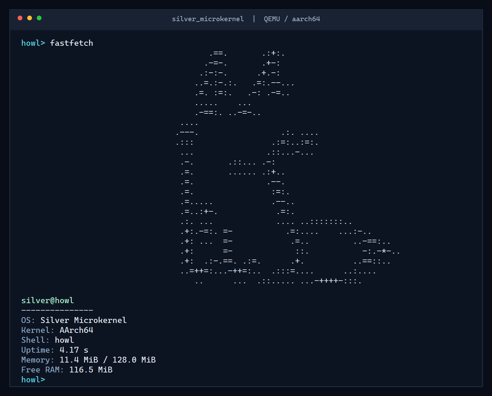

# silver_microkernel

A hobby microkernel for AArch64 (ARM64) written in Rust. The foundation is
bare-metal Rust (`no_std`), with drivers and services in C/C++ planned on top
of it. Cross-platform development: Windows and Linux (Arch) share the same
code — only the build commands and toolchain setup differ.

Target platform: QEMU `virt` machine (ARM Virt Board), Cortex-A72 CPU.

## Screenshot



The `fastfetch` screen above is real output from Silver Microkernel running in
QEMU. The interactive `howl` shell and the `howler` UART driver run in userspace.

## What already works

- [x] Bare-metal boot: `_start`, custom linker script, `.bss` zeroing
- [x] PL011 UART console input/output with IRQ-driven RX, echo and line editing
- [x] ARM64 exception vectors: SVC and IRQ trampolines, `panic!` file:line reports, EL0 fault containment
- [x] Physical memory map + page frame allocator (bitmap)
- [x] Kernel heap + Rust global allocator (`alloc`: `Box`, `Vec`)
- [x] GICv2 + ARM Generic Timer (IRQ 30, 100 Hz tick) + PL011 RX (INTID 33)
- [x] Round-robin scheduler: spawn with numeric/string arguments, `yield`, `sleep`, `kill`, `wait`
- [x] Console ownership + job control: `bg`/`fg`, Ctrl-Z, `Stopped`, resume and shell recovery
- [x] Lifecycle cleanup: address spaces, mailboxes, file handles, wait queues and owned mutexes
- [x] Blocking mutex with FIFO wait queue, ownership tracking and RAII guard
- [x] Bounded IPC: 16-message mailboxes, blocking send/backpressure and receive timeouts
- [x] IPC cleanup: queued-message disposal and blocked-sender wakeups on receiver exit
- [x] System calls via `svc #0` (number in x8, arguments in x0-x5)
- [x] Nameserver: register/lookup/unregister plus stale-owner cleanup
- [x] Condition variable: per-mailbox wait queues, targeted wakeups and timed waits
- [x] Counting semaphore + bounded channel with backpressure
- [x] MMU: 4-level tables, 4 KB granules, high-half kernel via TTBR1
- [x] Eleven userspace ELFs with checked `PT_LOAD` loading and BSS zeroing
- [x] Init architecture: `silverd` starts Scout, block driver, Howl and Howler, all resolved by program ID
- [x] howl: `help`, `fastfetch`, `ls`, `cat`, `echo`, `say`, `sl`, `mkdir`, `rm`, `rmdir`, `mv`, `cd`, `pwd`, `clear`, `uname`, `ps`, `spawn`, `bg`, `fg`, `kill`, `wait`
- [x] Shell output redirection: `>` truncates, `>>` appends, quoted operators stay literal
- [x] ANSI clear/home and a bold cyan `howl>` prompt
- [x] RAM-VFS: `/bin`, `/etc`, `/tmp`, files/directories and per-task descriptors
- [x] Per-task cwd inherited on spawn, absolute handles and `chdir`/`getcwd` syscalls
- [x] File syscalls: `open`, `read`, `write`, `create`, `close`, `read_dir`, `mkdir`, `unlink`, `rmdir`, `rename`
- [x] Shell syscalls: console ownership, resume, stopped-aware wait, uptime, memory and task info
- [x] Per-task TTBR0 spaces: independent ELF image, fixed-VA stack and private page
- [x] Growable per-task heap: sparse 2 MB window, `brk`, zero-fill and cleanup on exit
- [x] Userspace `malloc/free`: first-fit free list, split, coalesce and `brk` trim
- [x] Userspace `GlobalAlloc`: `Box`, growable `Vec` and deallocation in EL0
- [x] W^X user mappings: R-X text, R-- rodata, RW-NX data/heap/stack/private memory
- [x] No kernel image, kernel data, heap, kernel stacks or unauthorized MMIO in user TTBR0
- [x] Tasks in EL0 (Ring 3): user stacks and SVC-only kernel access
- [x] Capability-protected kill/wait/console/IRQ/MMIO operations and capability delegation
- [x] Userspace UART driver: IRQ-bound RX plus IPC-routed input and output
- [x] DMA infrastructure: contiguous frames and Normal Non-Cacheable user mappings
- [x] PCI ECAM access plus a Virtio-PCI block driver: modern capabilities, split virtqueue and `read_sector`
- [x] Checked copyin/copyout with permission validation, `LDTR/STTR` and PAN enabled
- [x] EL0 fault containment: bad user accesses kill the task, not the kernel
- [x] EL0 fault triage: `ESR_EL1`/`ELR_EL1`/`FAR_EL1` dump and a 16-entry context-switch trace before the guilty task dies
- [x] High-half and removed-alias probes: both fault without stopping other tasks
- [x] Kernel-stamped IPC senders, checked nameserver IDs, saturating sleep deadlines and release-safe mutex ownership
- [ ] SFS server, writes and interrupts on the block path, resource quotas and persistent storage

## Requirements

- Rust stable with the `aarch64-unknown-none` target
- QEMU with AArch64 system emulation

### Windows

```bash
# Rust + target
rustup target add aarch64-unknown-none

# QEMU: installer from https://www.qemu.org/download/#windows
# (path below is the installer's default)
```

### Arch Linux

```bash
sudo pacman -S qemu-system-aarch64 rustup
rustup target add aarch64-unknown-none
```

## Build and run

Windows (Git Bash), interactive shell:

```bash
export PATH="$(cygpath -u "$USERPROFILE")/.cargo/bin:$PATH"
cd "F:/My Projects/Silver microkernel"
cargo build --target aarch64-unknown-none --no-default-features --features no_std
"/c/Program Files/qemu/qemu-system-aarch64.exe" \
  -machine virt -cpu cortex-a72 -m 128M -nographic \
  -kernel target/aarch64-unknown-none/debug/silver_microkernel
```

Linux, interactive shell:

```bash
cargo build --target aarch64-unknown-none --no-default-features --features no_std
qemu-system-aarch64 \
  -machine virt -cpu cortex-a72 -m 128M -nographic \
  -kernel target/aarch64-unknown-none/debug/silver_microkernel
```

Linux, one-shot with the SFS disk attached (what `sfs_server` needs):

```bash
./build_and_qemu.sh            # release build + QEMU with disk.img via virtio-blk-pci
./build_and_qemu.sh debug      # same, debug build
./build_and_qemu.sh --no-run   # build only
```

The script attaches `disk.img` (SFS-formatted with `format_sfs.py`) as a
`virtio-blk-pci` device; without it the block driver reports "not
initialized" and the filesystem server exits with a stage-coded status.
Exit code diagnostics: the kernel prints `EXIT: task=… program=… status=…`
(0x…) for every exiting task; for `sfs_server` the status low byte names the
mount stage and bits 40-47 the block driver's init stage.

At the `howl>` prompt, `help` lists all commands. Backspace edits the
current line. A minimal file workflow looks like this:

```text
howl> ls
bin/
etc/
tmp/
howl> echo 'hello' > test.txt
howl> cat test.txt
hello
howl> echo 'again' >> test.txt
howl> cat test.txt
hello
again
howl> mkdir docs
howl> mv test.txt docs/readme.txt
howl> cat docs/readme.txt
hello
howl> rm docs/readme.txt
howl> rmdir docs
howl> cd /bin
howl> pwd
/bin
howl> ls
```

`ls`, `cat` and ordinary `echo` run as separate EL0 programs; they inherit the
shell's cwd, temporarily receive the console and return it when the shell has
consumed their exit status. Redirection, `mkdir`, `rm`, `rmdir`, `mv`, `cd` and
`pwd` use syscalls directly.

`spawn demo 12` and `bg demo 12` start a background task without console access.
`spawn` prints the child's Task ID and CapId. `fg <cap>` transfers the console
and waits; Ctrl-Z stops the foreground task and returns the shell prompt;
another `fg <cap>` resumes it. `kill <cap>` and `wait <cap>` require the
corresponding capability rights.

During normal boot, Howler owns PL011 in EL0: hardware IRQ 33 wakes the driver,
and input/output travel through IPC. The kernel retains a bounded RX fallback
for early diagnostics, demo tasks and recovery if Howler dies. The output sink is
resolved at runtime from the task bound to INTID 33, so console routing survives
any spawn order (`spawn block_driver` reusing Howler's old task ID cannot capture
the shell output).

`diskread [sector]` and `hexdump [sector]` talk to the block driver over IPC and
read real sectors from the attached `virtio-blk-pci` disk. Like the console sink,
the driver is found by program ID through `SYS_TASK_LIST`, never by a fixed task
number, and a request is bounded by a reply timeout. Killing or crashing the
driver therefore prints an error and returns the prompt; the kernel and the shell
keep running.

Press `Ctrl-A`, then `X`, to quit QEMU. For an unattended smoke test,
prefix QEMU with `timeout 5s`; exit code 124 then means the kernel stayed alive.

`Cargo.toml` has `std` (default host stub), `no_std` (bare metal) and
`demo-tasks` (opt-in regression programs). Normal bare-metal boot starts only
silverd, which then starts Scout, the block driver, Howl and Howler in that
order. No component depends on the resulting numbers: the console sink, Howler
and the block driver are all looked up by program ID at runtime, and the block
driver also answers whoever actually sent the request. To run
the fault/VM/allocator/IPC regression programs instead, use
`--features no_std,demo-tasks`. `build.rs` automatically builds and embeds every
userspace ELF; no separate userspace command is needed.

## Project layout

| File | Purpose |
| --- | --- |
| `build.rs` | Builds and embeds all eleven userspace ELFs for bare-metal profiles |
| `src/main.rs` | Physical boot entry, high-half transition, exception trampolines |
| `src/exceptions.rs` | EL0 fault register dump, switch trace and the kernel exit path |
| `src/pl011.rs` | Kernel UART diagnostics and bounded RX fallback |
| `src/memory.rs` | Physical memory map and high-half address conversion |
| `src/frame_allocator.rs` | Physical page frame allocator (bitmap) |
| `src/allocator.rs` | Kernel heap, `#[global_allocator]` |
| `src/gic.rs` | GICv2 timer/UART IRQ setup, EOI and userspace IRQ dispatch |
| `src/timer.rs` | ARM Generic Timer, tick counter |
| `src/interrupts.rs` | IRQ control: masking/restoring DAIF |
| `src/capability.rs` | Capability tables, rights, delegation and revocation |
| `src/scheduler.rs` | Tasks, capabilities, DMA ownership, console control and reaping |
| `src/mutex.rs` | Blocking mutex with FIFO waiters and ownership tracking |
| `src/wait_queue.rs` | Shared FIFO queue with dead-waiter removal |
| `src/ipc.rs` | Bounded mailboxes, backpressure, timed/selective receive and cleanup |
| `src/syscall.rs` | System call table and checked user-buffer operations |
| `src/user_memory.rs` | PAN-compatible `LDTR/STTR` copyin/copyout |
| `src/condvar.rs` | Condition variable: timed/infinite wait and targeted wakeups |
| `src/semaphore.rs` | Counting semaphore on mutex + condvar |
| `src/channel.rs` | Bounded channel: two semaphores + a mutex (backpressure) |
| `src/mmu.rs` | TTBR1 kernel map, per-task TTBR0 maps, permission validation |
| `src/elf_loader.rs` | Static ELF64/AArch64 `PT_LOAD` loader and image ownership |
| `src/user_program.rs` | Program IDs and embedded userspace ELF selection |
| `src/vfs.rs` | RAM file tree, normalized paths and per-task file descriptors |
| `userspace/src/allocator.rs` | Per-task first-fit `malloc/free` over `SYS_BRK` |
| `userspace/src/bin/silvershell.rs` | Interactive shell and `logo.txt` fastfetch screen |
| `userspace/src/bin/{ls,cat,echo}.rs` | Separate EL0 file/console utilities |
| `userspace/` | Separate demo, nameserver, shell and utility EL0 programs |
| `.cargo/config.toml` | Target, rust-lld linker, `-Tlinker.ld` flag |

## Memory model

The kernel is linked at high virtual addresses but loaded at low physical
addresses. The assembly boot stub builds temporary low/high aliases, enables
the MMU, branches to the high PC, and removes the kernel's low identity map.

```text
TTBR1 (EL1 only):  0xFFFF000000000000 + PA -> kernel image, heap, stacks, MMIO
TTBR0 (per task): own ELF + sparse heap + own fixed-VA stack + private page
```

The scheduler changes only TTBR0_EL1 and flushes stale TLB entries. Its EL1
code and SP_EL1 stack remain mapped through TTBR1_EL1. Every user task gets
an independently loaded ELF image at `0x40000000`, an 8 KB stack at
`0x7FE00000`, and a private 4 KB page at `0x0000_0080_0000_0000`. Equal VAs
in different tasks have different physical backing. VM A/B verify the private
page, ELF BSS and heap by reading back only their own values.

`SYS_BRK` manages a byte-granular program break in a reserved 2 MB heap window
at `0x40200000`. Growth maps zeroed RW-NX pages on demand; shrinking unmaps and
frees whole pages; failed growth rolls back partial mappings. Reaping frees
all remaining heap frames.

`userspace/src/allocator.rs` provides explicit 16-byte-aligned `malloc/free`.
It uses first-fit, splits large free blocks, keeps the list address-sorted and
coalesces adjacent blocks. Freeing a tail block also shrinks `brk`, returning
whole pages to the kernel. Tests verify same-address reuse, neighbor integrity
and restoration of the initial program break.

The demo ELF registers this allocator as `#[global_allocator]`, so `Box`, `Vec`
and default `GlobalAlloc` reallocation work in EL0. Layouts requiring alignment
above 16 bytes and OOM terminate only the current task with diagnostics. The
EL0 test grows a 32-element `Vec`, checks `Box::new(42)` and verifies `brk` trim
after both values are dropped.

The userspace linker emits separate R-X, R-- and RW `PT_LOAD` segments. The
loader accepts static ELF64/AArch64 `ET_EXEC` files inside a 2 MB image window,
rejects W+X or incompatible page permissions, copies file bytes into fresh
frames and zero-fills BSS. There is no shared kernel `.text` / `.rodata` alias
left in TTBR0.

All demo tasks except idle run at EL0t and enter the kernel only through
`svc #0`. Copyin/copyout validates mapping and read/write permissions through
the current TTBR0, then uses unprivileged `LDTRB/STTRB` while SCTLR.PAN is
enabled. Read-only and unmapped output buffers are rejected before a receive
can block.

Two intentional probes prove isolation: task 15 reads
`0xFFFF000040000000` (high-half kernel) and task 16 reads
`0x0000000040080000` (the old kernel text alias). Each must produce one
`EL0 SYNC FAULT!` block (`ESR_EL1`, `ELR_EL1`, `FAR_EL1` and the switch trace;
`ESR_EL1 >> 26 = 0x24`, a data abort from EL0); all other tasks continue
running.

`spawn(program, argument)` selects a registered ELF and passes a numeric argument
to its entry point. `spawn_with_args` additionally copies a bounded byte string
for `SYS_ARGS`. `kill` rejects idle/self and terminates another task with status
1. `wait(id)` blocks until termination and consumes a bounded completion record,
so it also works after the task's memory has been reaped. The lifecycle demo
proves that reaping releases resources. Nameserver RPC uses selective receive
so unrelated messages cannot be consumed as lookup responses.

The RAM-VFS starts with `/bin`, `/etc` and `/tmp`. Each task owns an absolute
cwd and children inherit it on spawn. Relative paths resolve from that cwd;
`.` and `..` are normalized without escaping root. `SYS_CHDIR` validates the
target directory and `SYS_GETCWD` copies the absolute cwd to userspace. Open
handles retain absolute paths, so later `cd` calls do not change their target.
Files are volatile and live in kernel heap memory. Descriptors start at 3,
belong to one task, track their offset and close automatically on exit or kill.
Path and I/O buffers are bounded and all user pointers pass checked copying.
`create` truncates an existing file; `mkdir` rejects duplicates. `OPEN_APPEND`
requires write mode and moves every write to the current EOF. `unlink` refuses
files that still have open descriptors (there is no Unix-style unlink-while-open
yet). `rmdir` accepts only empty directories and rejects root or any directory
that contains a live task's cwd. `rename`/`mv` never replaces an existing node,
rejects self/subtree moves and pins sources with open files or active directory
cwds.

Each mailbox holds at most 16 messages. A sender blocks on `not_full` while the
queue is full; removing any message wakes one sender. `SYS_RECEIVE(buffer, ticks)`
uses `0` for polling, `u64::MAX` for infinite waiting and any other value as a
relative timer-tick timeout. It returns `SYSCALL_TIMEOUT` (`u64::MAX - 1`) on
expiry. Receiver exit clears queued messages, wakes all blocked senders and makes
their sends fail instead of recreating the dead mailbox. Demos verify timeout,
backpressure on the seventeenth send, FIFO delivery and exit wakeup.

## Security notes

The kernel stamps every IPC sender after checked copyin, rejects non-owner mutex
unlock in all build profiles, parses nameserver IDs with checked arithmetic and
uses saturating sleep deadlines. Debug and release regression probes cover these
paths alongside the existing MMU, copyout, lifecycle and IPC checks.

This is not yet a complete security model. Kill, wait, console, resume, MMIO,
IRQ and PCI operations check capability rights; `SYS_CAP_GRANT` delegates only a
subset of the caller's rights, and task death revokes or downgrades affected
capabilities. Spawn, heap, DMA, VFS and wait-queue resource quotas are still
limited or absent, so denial-of-service resistance remains incomplete.

Architecture details, invariants and the roadmap: [handoff.md](handoff.md).

## License

This project is licensed under the [MIT License](LICENSE).
