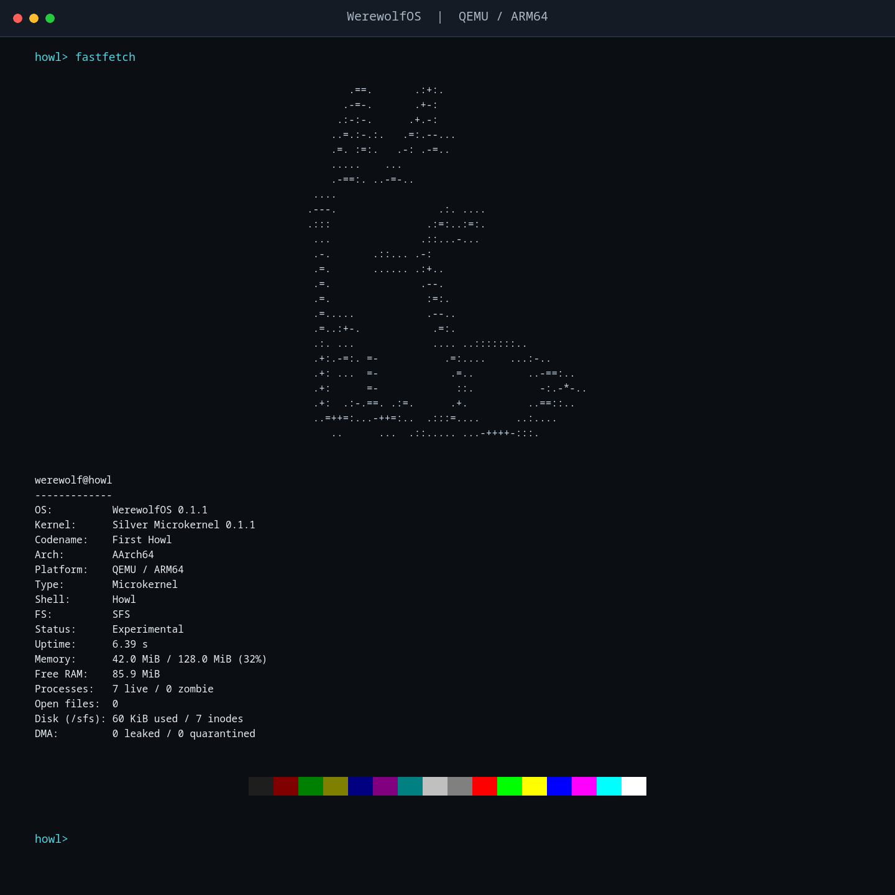

# WerewolfOS / Silver Kernel

WerewolfOS is an open mobile operating system built around the Silver Kernel:
an AArch64 microkernel written in Rust. The kernel stays small and security-
focused; drivers, services, Howl and applications run in isolated EL0 tasks.
The architecture is inspired by XNU, Redox and other proven systems, but the
interfaces, capability model, SFS format and userspace are original.

Active target: QEMU `virt` (ARM Virt Board), Cortex-A72, developed from a
Linux desktop. The product is a **console OS that provides the base OS**
(kernel, drivers, network, files); applications — including the browser — come
from Linux through the compatibility layer. **Linux ABI + Phosh is the active
long-term goal** (owner decision: months, not years). The Legion Y700 tablet
target is forgotten; the Redmi 10C hardware port is parked until the OS layer
is ready (see [redmi10c_poc/README.md](redmi10c_poc/README.md)).

## Project direction (2026-11-09)

The project is a **console-first OS that provides the base OS**: kernel,
drivers, networking, files and basic operations stay native. Applications —
including the browser — come **from Linux through a compatibility layer**
instead of being rewritten in the native userspace. **Linux ABI + Phosh is the
active goal**; Wolfser is a temporary browser (a stopgap) and is not the
product path.

Active vector:

1. **Console OS / base**: Silver kernel + SFS + network + Howl + Unix toolbox.
   `net_server`/smoltcp (DHCP, DNS, TCP, HTTP, TLS) is deliberately ours.
2. **Linux ABI module**: an optional (`linux-abi`) layer that loads foreign
   AArch64 ELFs, implements the Linux syscall personality and maps it onto our
   VFS and drivers. With the feature off, none of it is linked in.
3. **Phosh**: a software-rendered headless Wayland stack on top of the Linux
   layer, exported into a host window.

Wolfser (the guest litehtml browser in the host-Qt window) remains available
so pages can be viewed before the Linux stack is ready, but it is frozen
except for bug fixes. See [`docs/VECTOR.md`](docs/VECTOR.md).

The tablet is out. Hardware phones are parked behind the QEMU/desktop
milestone.

## Community

🐺 Developer Telegram: [Сильвер не кодит](https://t.me/rustdev_rs)

## Screenshot



The `fastfetch` screen above is real output from WerewolfOS 0.1.1
(Silver Microkernel) running in QEMU. The aligned summary includes processes,
open files, SFS usage and DMA state. The interactive `howl` shell and the
`howler` UART driver run in userspace.

## What already works

- [x] Bare-metal boot: `_start`, custom linker script, `.bss` zeroing
- [x] PL011 UART console input/output with IRQ-driven RX, echo and line editing
- [x] ARM64 exception vectors: SVC and IRQ trampolines, `panic!` file:line reports, EL0 fault containment
- [x] Physical memory map + page frame allocator (bitmap)
- [x] Kernel heap + Rust global allocator (`alloc`: `Box`, `Vec`)
- [x] GICv2 + ARM Generic Timer (QEMU: IRQ 30, 100 Hz tick) + PL011 RX (INTID 33); runtime GICv3 dispatch for SM8650/fog
- [x] Round-robin scheduler: spawn with numeric/string arguments, `yield`, `sleep`, `kill`, `wait`
- [x] Per-CPU FIFO ready queues: dispatch order is enqueue order (the old stack-shaped queue starved the oldest of three runnable tasks; a boot test fails on the stack version)
- [x] Per-CPU stall watchdog: a PE that stops taking its timer PPI or completing scheduling passes is reported with CPU id and scheduler index; an opt-in `smp-churn` injection proves the detector
- [x] Priority classes with aging: high/normal/low, FIFO inside a class, and a low-class task promoted after two aging windows so continuous high-class work cannot starve it (boot test; disabling aging fails it)
- [x] Push migration: a CPU that still has queued work after a dispatch hands one task to an idle, empty peer without resetting its aging; the dispatch mix reports the `push=` count
- [x] Kernel-lock stall detector: a waiter that cannot take the BKL for one second reports the holder (CPU, depth, current task) once per episode; the boot test proves it, and there is no recovery by design
- [x] Data/instruction caches: after the page tables are published the boot CPU drops the inherited cache state and sets `SCTLR_EL1.C/I`; every AP does the same before touching shared state, each CPU records the value it read back, and the boot test requires `C=1 I=1` on every online CPU (`CACHE=ON line=<n>` in the boot log)
- [x] User-memory reserve: anonymous `mmap`, `brk`, DMA, ELF-image and per-task stack frames are refused once granting them would drop free frames below 1/8 of RAM (capped at half), so user tasks cannot starve the kernel; the boot test proves the gate is one-sided (`MEM RESERVE PASS`)
- [x] Per-task memory ledger: every frame a task can pin (address-space tables, stacks, ELF image, `brk`, `mmap`, DMA) is charged to one counter bounded at 1/4 of usable RAM; the boot test charges, refuses past a forced limit, releases and reopens the gate (`TASK LEDGER PASS`)
- [x] Partial `munmap`: any page-aligned sub-range of one anonymous mapping is unmapped, its frames are returned to the allocator, and the bookkeeping splits into up to two regions; a hole is reusable by the next first-fit `mmap`. Host-tested range math plus a boot proof (`MMAP SPLIT PASS`)
- [x] Console ownership + job control: `bg`/`fg`, Ctrl-Z, `Stopped`, resume and shell recovery
- [x] Lifecycle cleanup: address spaces, mailboxes, file handles, wait queues and owned mutexes
- [x] Blocking mutex with FIFO wait queue, ownership tracking and RAII guard
- [x] Bounded IPC: 16-message mailboxes, blocking send/backpressure and receive timeouts
- [x] IPC cleanup: queued-message disposal and blocked-sender wakeups on receiver exit
- [x] System calls via `svc #0` (number in x8, arguments in x0-x5)
- [x] Nameserver: register/lookup/unregister plus stale-owner cleanup
- [x] Condition variable: per-mailbox wait queues, targeted wakeups and timed waits
- [x] Counting semaphore + bounded channel with backpressure
- [x] MMU: 4-level tables, 4 KB granules, high-half kernel via TTBR1
- [x] Userspace ELFs (apps, drivers, shell and probes) with checked `PT_LOAD` loading and BSS zeroing
- [x] Init architecture: `silverd` starts Scout, the block, network, graphics and input drivers, the SFS and network servers, Howl and Howler, all resolved by program ID
- [x] howl: `help`, `fastfetch`, `ls`, `cat`, `echo`, `say`, `sl`, `run`, `mkdir`, `rm`, `rmdir`, `mv`, `replace`, `cd`, `pwd`, `clear`, `uname`, `ps`, `spawn`, `bg`, `fg`, `kill`, `wait`, `health`, `du`
- [x] Shell output redirection: `>` truncates, `>>` appends, quoted operators stay literal
- [x] ANSI clear/home and a bold cyan `howl>` prompt
- [x] RAM-VFS: `/bin`, `/etc`, `/tmp`, files/directories and per-task descriptors
- [x] Per-task cwd inherited on spawn, absolute handles and `chdir`/`getcwd` syscalls
- [x] File syscalls: `open`, `read`, `write`, `create`, `close`, `read_dir`, `mkdir`, `unlink`, `rmdir`, `rename`
- [x] Shell syscalls: console ownership, resume, stopped-aware wait, uptime, memory and task info
- [x] Per-task TTBR0 spaces: independent ELF image, fixed-VA stack and private page
- [x] Growable per-task heap: sparse 2 MB window, `brk`, zero-fill and cleanup on exit
- [x] Userspace `malloc/free`: first-fit free list, split, coalesce and `brk` trim
- [x] Userspace `GlobalAlloc`: `Box`, growable `Vec` and deallocation in EL0
- [x] W^X user mappings: R-X text, R-- rodata, RW-NX data/heap/stack/private memory
- [x] No kernel image, kernel data, heap, kernel stacks or unauthorized MMIO in user TTBR0
- [x] Tasks in EL0 (userspace): user stacks and SVC-only kernel access
- [x] Capability-protected kill/wait/console/IRQ/MMIO operations and capability delegation
- [x] Capability split between target rights and process-wide rights; child handles cannot become parent privileges
- [x] Userspace UART driver: IRQ-bound RX plus IPC-routed input and output
- [x] DMA infrastructure: contiguous frames and Normal Non-Cacheable user mappings
- [x] PCI ECAM access plus a Virtio-PCI block driver: modern capabilities, split virtqueue and `read_sector`
- [x] VirtIO-Net driver: modern virtio-pci capabilities, split RX/TX virtqueues, 16 x 2 KiB buffers and MAC discovery
- [x] Shared-memory frame transport: one 8 KiB DMA mailbox, `OP_ATTACH`/`OP_ATTACHED`, `OP_FRAME`/`OP_TX` doorbells, length-word fencing and backpressure
- [x] `net_server`: `smoltcp` in a separate EL0 task with DHCP, ARP, IPv4, DNS and TCP; a static 10.0.2.15/24 fallback keeps a NIC-less or DHCP-less boot usable
- [x] ICMP ping end-to-end: `ping <ip>` shell command with strict IPv4 parsing and timeout, verified against 8.8.8.8
- [x] DNS: `dns <name>` resolves through the DHCP-provided resolver
- [x] HTTP: `wget <url> [file]` fetches an `http://` document through a real TCP connection into SFS; `ip` shows the lease
- [x] Vendored `smoltcp` 0.14 with a two-line neighbour fix for broadcast DHCP traffic (`third_party/smoltcp/PATCH.md`)
- [x] **Wolfser**: `wolfser [query|url]` opens a search/address bar; pages render into an ivshmem RGBA surface with clickable links, back/forward history, find-in-page, a start page with persistent bookmarks, six tabs and window zoom. The primary renderer is **litehtml** (HTML5 + CSS layout, article reader extraction, in-guest PNG/JPEG/GIF images); the old text renderer stays as a fallback. `http://` and `https://` use the guest stack (TLS 1.3); the host viewer's Qt TLS proxy is the fallback
- [x] Qt window viewer (`tools/window-viewer`) that maps the same surface, repaints on `frame_seq`, and sends keys/wheel through an input ring; `--snapshot` mode for headless checks
- [x] `SYS_MAP_PHYS_NC`: maps a non-DRAM window (ivshmem) as Normal Non-Cacheable user memory
- [x] Checked copyin/copyout with permission validation, `LDTR/STTR` and PAN enabled
- [x] EL0 fault containment: bad user accesses kill the task, not the kernel
- [x] EL0 fault triage: `ESR_EL1`/`ELR_EL1`/`FAR_EL1` dump and a 16-entry context-switch trace before the guilty task dies
- [x] High-half and removed-alias probes: both fault without stopping other tasks
- [x] Kernel-stamped IPC senders, checked nameserver IDs, saturating sleep deadlines and release-safe mutex ownership
- [x] Kernel health snapshot (`SYS_HEALTH`, `health`) for frames, tasks, open files and DMA leak counters
- [x] Dynamic ELF loader: `run <path>` loads an ELF64 file from the VFS into a fresh EL0 task with its own W^X address space
- [x] EL0 fault containment: a crashed EL0 task (e.g. `run bin/crash`) is killed with a `Task X killed: Page Fault` log and the shell keeps running
- [x] Unix-style toolbox: a multi-call `utils` ELF with `grep`, `wc`, `head`, `tail`, `cp`, `find`, `seq`, `basename`, `dirname`, `true`, `false` and `sleep`; `echo` redirection is line-terminated and the shell input queue no longer drops bursts
- [x] Power control: `poweroff` and `reboot` shell commands through PSCI (`SMC` on hardware, `HVC` on QEMU with `virtualization=on`)
- [x] *(parked)* Redmi 10C (`fog`, SM6225) RAM-only path: live-FDT probe, memory planner, GENI UART, GICv3/timer selection and fail-closed relocation with pre-copy FDT destination validation (QEMU-verified, and booted on a physical `rain` unit)
- [x] *(parked)* Real Redmi 10C boot: RAM-only `fastboot boot` reaches the scheduler and the Howl task, with live GICv3 timer interrupts (verified on a `rain` unit)
- [x] Boot-time MMU TLB proof: read through TTBR0, remap the same VA, read again (fails the boot if the `tlbi` broadcast is missing)
- [x] Per-task anonymous-mapping quota (16 MiB), DMA quarantine and per-task memory ledger
- [x] Kernel-owned persistent SFS: read/write, positioned writes, directories, single/double-indirect files and fsck
- [x] SFS manifest write scopes, per-task open-file quota (32), global VFS budget and lifecycle cleanup
- [x] Atomic file replacement (`replace`, `SYS_FS_REPLACE`) for bundle updates without exposing a half-written file
- [x] SHA-256 bundle integrity: manifest `sha256=` is checked before an ELF becomes a task
- [x] Ed25519 bundle signatures: `sig=` over the digest, enforced when a trusted public key is compiled in
- [x] Versioned `SYS_MEMINFO_V2` resource diagnostics for the current task
- [x] SFS per-bundle block/inode quotas (`quota=`), `SYS_FS_USAGE` and `du`
- [ ] SFS metadata journal and crash recovery beyond the current quota/atomic-replace tests
- [ ] SMP (`-smp 4/6`): **QEMU-only, opt-in** — see `SMP_STATUS.md`. `no_std,smp` brings up to seven APs online (CPU slots 1–7), runs tasks on every CPU and passes the `demo-tasks` regression on `-smp 4` and `-smp 6`. Dispatch uses per-CPU FIFO ready queues (local queue → steal from a peer → full-scan fallback), with entries carrying `(id, index)` so an index shift can only discard an entry. Every address space carries a unique 8-bit ASID, so a context switch no longer flushes the domain-wide TLB and a PTE edit invalidates only the edited ASID. `no_std,smp-selftest` additionally runs a cross-PE TLB probe (every AP reads a VA, the boot CPU re-points the same PTE, every AP must observe the new frame), 64 back-to-back SGI1 stop-the-world rounds, a per-CPU timer-tick check, a `running_on`/`current_index` pairing check on every scheduling pass, a FIFO-order probe, a priority/aging probe, a push-migration probe, the BKL stall detector, the stall-watchdog policy and heartbeat checks, and a one-shot `ready queues local/steal/scan/push` report. An opt-in `smp-churn` diagnostic spawns short-lived kernel tasks while the APs run/reap them, with the per-pass invariant audit active; it found and now regression-tests three scheduler bugs (preemptible passes, kernel-task lock imbalance, IRQ window in lock acquisition). It also injects a real masked-IRQ stall and requires another PE to report it (`watchdog stall PASS`). It stays opt-in because it is a stress/injection suite, not a correctness prerequisite; both parts pass on `-smp 2`, `-smp 3` and `-smp 4`. Console writes are serialized across CPUs; whole-line interleaving at call boundaries is still possible. Device-DMA quiescence is enforced for in-kernel `DmaLease` holders (a live lease makes revoke leak instead of reuse); userspace drivers still rely on the quarantine window. Physical SMP and in-flight-MMAP stress remain unverified; fog/tablet stay single-core. Do not boot on hardware expecting SMP.

## Design references

WerewolfOS is not a port of another OS. Two systems are used as **conceptual**
references, not as source:

- **XNU (aarch64)** — `pmap`-style batched page-table publication with a single
  shootdown, quiescence before frame reclamation, per-CPU scheduler state and a
  global lock where the fast path is not yet split.
- **Redox (Rust)** — ownership-based lifetimes for wait queues (`Arc`), typed
  capability tables, and explicit lock-scope/ordering documentation.

Where a reference design conflicts with this kernel's microkernel boundaries,
capability model or hardware profiles, the kernel's own invariants and tests
win. No XNU or Redox code is copied.

## Project naming

- **WerewolfOS** — the complete operating system and userspace platform.
- **Silver Kernel** — the Rust microkernel.
- **Howl** — the interactive shell and console-facing userspace.
- **silverd** — the service manager.
- **gpu_driver**, **input_driver**, **net_driver**, **net_server** — isolated
  wolf-themed system components; they communicate through IPC and capabilities.

## Redmi 10C (`fog`, SM6225) — RAM-only bring-up (parked)

> The active vector is QEMU/desktop + Linux ABI/Phosh. This hardware port is
> kept as a documented later milestone, not an active deliverable.

Status as of 2026-11-03 (TASK №19–№23). The authoritative port document is
[redmi10c_poc/README.md](redmi10c_poc/README.md).

Implemented:

- [x] Separate `fog` platform kind and `linker_fog.ld` (DRAM base `0x4000_0000`,
      link slot `0x4008_0000`)
- [x] ARM64 Image header, hand-over capture (`x0` DTB, `CurrentEL`, `SCTLR_EL1`,
      `MPIDR_EL1`, actual PC) and a fixed-layout `BOOT_PARAMS` record
- [x] Allocation-free FDT parser plus a memory planner that subtracts
      `/memory`, `/reserved-memory`, the memreserve map, the loaded image and
      the DTB
- [x] Live khaje/SM6225 probe; compile-time addresses are fallbacks, not
      asserted hardware facts
- [x] GENI UART TX/polled RX and runtime GICv3/timer/UART INTID selection
- [x] GICv3 redistributor lookup by `GICR_TYPER` affinity, with no frame-0
      fallback; the timer is not armed when no redistributor matches
- [x] Fog scheduler path: idle, Scout and Howl; Howl falls back to `SYS_READ`
- [x] **Fail-closed relocation by default.** A standard `fog` build never
      copies the image. If ABL enters it at anything other than the link
      address, it records `pc`/`link`/`delta` in `BOOT_PARAMS` and parks.
- [x] Opt-in `fog-reloc` feature for controlled experiments. Before copying it
      validates the ARM64 header, image size, both source and destination span
      ends, overflow and every overlap, **and** reads the live FDT to prove the
      destination is inside `/memory` and outside every reservation,
      memreserve, the DTB and the running source image. Unknown cell layouts,
      non-empty `/reserved-memory` `ranges` and malformed trees fail closed.
- [x] RAM-only boot image v3 builder (builds only; never flashes or runs a
      device command)
- [x] Real-device boot on a Redmi 10C `rain` unit: `fastboot boot` reaches the
      scheduler and the Howl task, with live GICv3 timer interrupts

The default fog image is intentionally conservative: it will not write outside
its own loaded image when the placement is unexpected. `fog-reloc` now performs
the pre-copy live-FDT proof, but it remains an opt-in experiment: the check is
deliberately conservative (2/2 cells, no `ranges` translation), and no real
device has been booted with it yet.

```bash
# Kernel (default, fail-closed)
cargo build --release --target aarch64-unknown-none \
    --no-default-features --features no_std,fog

# QEMU-only SMP (up to 8 CPU slots; run QEMU with -smp 4 or -smp 6): APs online,
# GIC/timer/IPI and task execution on every PE
cargo build --release --target aarch64-unknown-none \
    --no-default-features --features no_std,smp

# Same, plus 64 boot-time SGI1 stop-the-world rounds and a per-CPU timer check
cargo build --release --target aarch64-unknown-none \
    --no-default-features --features no_std,smp-selftest

# Explicit relocation experiment (only after proving the destination)
cargo build --release --target aarch64-unknown-none \
    --no-default-features --features no_std,fog,fog-reloc

# QEMU integration: relocation, at-link boot and fail-closed park
redmi10c_poc/test_fog_qemu.sh

# Boot image v3 (build only, no device operation)
redmi10c_poc/build_boot_image.sh
```

QEMU validates only the Silver-side logic (FDT, planner, relocation policy,
GICv3/timer and the Howl path). It does **not** prove GENI, khaje GIC/timer,
the live memory map or the ABL load address on a real unit.

## Phase 4: Network — complete

The network stack works end-to-end and is driven from the shell. Working: the
VirtIO-Net driver, the userspace `smoltcp` server, shared-memory IPC over a DMA
mailbox, and a `ping <ip>` command with strict IPv4 validation and a timeout.

```text
howl> ping 8.8.8.8
PING 8.8.8.8:  OK
```

The reply has crossed the NIC, both virtio queues, the DMA mailbox in both
directions, smoltcp's ARP and IPv4/ICMP layers, and the checksum check. Any
IPv4 address can be pinged — not only the slirp gateway — and success is
reported only on a matching echo reply before the timeout.

## Phase 5: Graphics — removed (2026-11-08)

The compositor, framebuffer backends, kernel surface objects and the input
driver were deleted. The development vector was reconsidered: a full graphical
OS is outside the project's scope, so the product is a console system. A single
window will return later only as a host for a basic browser, with its own
minimal display path.

`build_and_qemu.sh` boots the console OS with `-display none`; the shell runs
over the serial line.

## Phase 6: Dynamic ELF loader — complete

The kernel can now load an ELF64 binary from the RAM-VFS into a fresh EL0
task — the binary no longer has to be embedded at build time. `src/elf.rs`
parses the header and program table (`load_elf -> LoadedImage { physical_start,
page_count, entry, kinds }`), allocates a frame per `PT_LOAD` page, copies file
bytes, zero-fills BSS and enforces W^X with per-page `PageKind` permissions
(Text R-X, ReadOnly R--, Data RW).

```text
howl> run bin/hello
Spawning ELF at 0x0000000040000000 with stack at 0x000000007FE00000
Hello from ELF!
```

The path is: `run <path>` in the shell → `SYS_SPAWN_PATH` (the kernel reads the
file by path, since the ELF is far larger than the 4 KiB copyin limit) →
`elf::load_elf` → `spawn_elf`, which builds TTBR0, maps the image and the user
stack (`0x7FE0_0000`, 2 pages), sets the entry point and returns a capability
handle so the shell can lend the console and wait. The new task starts with an
empty capability table — any device rights must be delegated by its parent. A
dynamically loaded task shows up in `ps` as `elf` (`PROGRAM_DYNAMIC =
u64::MAX - 1`).

`/bin/hello` is seeded into the VFS at boot from the build artefact
(`src/seed.rs`, `include_bytes!(OUT_DIR/hello.elf)`). `hello.elf` is built by
`build.rs` like every other binary but deliberately omitted from the embedded
program table, so `run bin/hello` is the only way to execute it — proving the
loader path end-to-end. The embedded `spawn` path is unchanged and shares the
same `elf::load_elf` (via the thin `elf_loader` shim).

### Linux ABI module (optional)

The whole Linux track is one Cargo feature, `linux-abi`. Without it the kernel
and the console userspace contain **no** Linux ELF loader, no Linux syscall
translation and no `linuxrun`: the loader module, the `mmu` install paths and
the shell command do not exist in the binary. Nothing else in the OS depends
on them. The removal switch is `./build_and_qemu.sh --no-linux` (or just
`--features no_std`), and the module can be deleted from the tree without
touching the rest of the system.

With the feature on, `linuxrun <path>` loads the same way but spawns the task
with the **AArch64 Linux** syscall personality: `x8` carries a Linux syscall
number and `src/linux_abi.rs` translates it. The initial stack is the Linux
layout (`argc/argv/envp/auxv`, including `AT_PAGESZ`, `AT_ENTRY`, `AT_PHDR`,
`AT_RANDOM`). Implemented so far: `write` (stdout/stderr), `read` (fd 0 as
EOF), `exit`/`exit_group`, `set_tid_address`, `set_robust_list`,
`clock_gettime`, `rt_sigprocmask`, `uname`, `getpid`/`getppid`/`gettid`,
`brk`, `mmap`, `munmap`, `mprotect`, `prlimit64`, `getrandom`, `fstat`,
`ioctl(TIOCGWINSZ)`, `writev`, `close`, `lseek`, `readlinkat`, `sched_yield`,
`openat`, `getdents64`, `newfstatat`, `dup`/`dup2`/`dup3`, `fcntl`, `getcwd`,
`chdir`, `nanosleep`/`clock_nanosleep`, `clock_getres`, `gettimeofday`,
`getrlimit`, `getuid`/`geteuid`/`getgid`/`getegid`, `sched_getaffinity`,
`prctl`, `execve`, `clone` (fork semantics), `wait4`, `pipe2`, `ppoll`,
`eventfd2`, `memfd_create`, `futex`, `rt_sigaction`, `rt_sigprocmask`, `kill`
and `tgkill`; anything else returns `-ENOSYS`. File descriptors are a
per-process table in `src/linux_fd.rs` (console, `/dev` devices, VFS handles,
pipes, eventfds, memfds, timerfds, epoll instances or Unix sockets), so `dup2`
redirects work; the filesystem view is read-only.

The personality is fixed at spawn, so a foreign binary can never reach the
Silver syscall table by choosing a colliding number. `linuxrun` is a
foreground command: the kernel assigns it the console inside the spawn
syscall, before the child can be dispatched on any CPU, then returns; the
shell only waits. (Assigning the console from userspace after spawn is racy —
an AP can run and even exit the child first.)

`load_linux_elf` honours the file's own `p_vaddr`, so a normal Linux binary at
`0x40_0000` loads: each `PT_LOAD` segment gets its own physical run, gaps are
allowed, text is mapped RX, data RW and BSS is zero-filled. The per-2 MiB L3
tables (and a per-1 GiB L2 table for the low window) are allocated on demand
and registered with the space root, so the normal teardown frees them.

`tests/linux/` and `tools/linux-test.sh` build the raw-syscall programs,
install them with `scripts/sfs_inject.py`, and verify the path in QEMU:

```text
howl> linuxrun /sfs/linux-hello
hello from linux abi
Program exited with status 42

howl> linuxrun /sfs/linux-rw
RW data+bss ok
Program exited with status 7

howl> linuxrun /sfs/linux-libc
hello from libc
Program exited with status 0
```

The last one is a **real static glibc binary** (libc initialisation, stdio,
`open`/`read`/`close`, `opendir`/`readdir`, `exit`), which is the point of the
track. The loader reads up to 8 MiB through `vfs::read_file_limit`; the
general VFS cap is the same 8 MiB (the SFS double-indirect limit is about
8.26 MiB), and the transient read is exactly file-sized.
`fstat`, `ioctl(TIOCGWINSZ)`, `writev`, `close`, `lseek`, `readlinkat` and
`sched_yield` are implemented, and `--features linux-abi-trace` logs any
still-unsupported number (capped) so the next slice is driven by what a libc
actually calls.

File descriptors are a real **process table** in the Linux layer
(`src/linux_fd.rs`), because Linux semantics need more than the VFS exposes:
0/1/2 start as console handles, `dup2` can redirect stdout to a file, and
`/dev/null`, `/dev/zero`, `/dev/full` and `/dev/urandom` are synthetic devices
with no inode. Entries 3+ point at real Silver VFS descriptors, so the storage
layer stays ours and `vfs::close_task` releases the handles on exit. The table
is dropped with the task; with the `linux-abi` feature off it does not exist.

The Linux view of the filesystem is **read-only** for now: write intents on
real files fail with `-EROFS` (devices still accept writes). The test prints:

```text
howl> linuxrun /sfs/linux-libc
hello from libc
readme!!
entries=5
```

It also redirects stdout to `/dev/null` through `dup`/`dup2`, reads
`/dev/urandom`, checks `chdir`/`getcwd` and sleeps with `nanosleep`.

`execve` is implemented as a real image replacement: a new address space and
user stack are built while the old one is still current, then the CPU switches
over and the old space, heap, mappings, image and stack are released. The task
id, capabilities, cwd and fd table survive. A freestanding test replaces
itself with the hello binary:

```text
howl> linuxrun /sfs/linux-chain
hello from linux abi
Program exited with status 42
```

`fork` is a real `clone(SIGCHLD)` with **copy-on-write**: the image, heap,
anonymous mappings, private page and user stack are shared through frame
refcounts, writable pages are mapped read-only in both address spaces, and the
first write faults into a handler that copies the containing run and remaps it
writable. Text and rodata stay read-only for both. The fd table and cwd are
duplicated, and the child resumes from the same `svc` with `x0 = 0` while the
parent receives the pid. `wait4` blocks until the child is a zombie, reaps it,
and returns the Linux status word. A freestanding test forks, the child
`execve`s the hello binary, and the parent checks
`WEXITSTATUS(status) == 42`:

```text
howl> linuxrun /sfs/linux-fork
hello from linux abi
parent saw child 42
```

Forked Linux children may write to the console even though only the foreground
task owns it in the Silver model; that matches a terminal shared by a process
tree. The COW test writes distinct values into image data, an anonymous
mapping, `brk` and the stack from both processes and verifies isolation:

```text
howl> linuxrun /sfs/linux-cowfork
cow fork ok
```

`pipe2` creates a real 4 KiB kernel pipe shared by both descriptors and
inherited across `fork`; a blocking read/write sleeps and re-checks the buffer
(EOF when every write end closes), and `ppoll` reports
`POLLIN`/`POLLOUT`/`POLLHUP` for pipes, files, `/dev` nodes and the console,
with a timeout. A raw test forks, the child writes, and the parent polls and
reads:

```text
howl> linuxrun /sfs/linux-pipe
pipe: ping
```

`eventfd2` (counter shared by dup/fork, `ppoll`-able), `memfd_create`
(anonymous in-memory file with read/write/lseek/fstat) and `futex`
(`FUTEX_WAIT` blocks until `FUTEX_WAKE` or timeout) are available:

```text
howl> linuxrun /sfs/linux-ipc
ipc ok
```

`AF_UNIX` stream pairs are available through `socketpair(2)`. A message may
carry descriptors with `SCM_RIGHTS`; `recvmsg` installs them in the receiver's
table, and the reference counting follows `dup`/`fork`/`close` so a closed
writer produces EOF. `ppoll` reports `POLLIN`/`POLLOUT`/`POLLHUP`, `O_NONBLOCK`
comes from `fcntl`, and `shutdown` delivers the half-close. This is the
transport Wayland and D-Bus use:

```text
howl> linuxrun /sfs/linux-unixsock
unix socket ok

howl> linuxrun /sfs/linux-sockets
glibc socket ok
```

Named `AF_UNIX` sockets work through a path registry:
`socket(AF_UNIX, SOCK_STREAM)` returns an unbound endpoint, `bind` reserves a
filesystem or abstract name (`EADDRINUSE` on a duplicate), `listen` arms the
backlog, `connect` joins a listener and turns the caller's descriptor into the
client end, and `accept`/`accept4` hand out the server end. `getsockname`
returns the bound name with the Linux NUL-terminated length. The name does not
need a file on disk yet, which is how Wayland and D-Bus address each other:

```text
howl> linuxrun /sfs/linux-namedsock
named socket ok
```

Accepted descriptors support everything a pair does, including `SCM_RIGHTS`.
A writable runtime directory (for socket lock files and `XDG_RUNTIME_DIR`) is
still the next step.

Signals keep per-task dispositions, blocked masks and pending bits.
`rt_sigaction`/`rt_sigprocmask` round-trip, `kill`/`tgkill` apply the default
actions (`SIGKILL` and default-terminating signals end the target, ignored
signals are no-ops) and a child's exit raises `SIGCHLD` in the parent.
User-installed handlers now run: the kernel writes an AArch64 `rt_sigframe`
(`siginfo` + `ucontext`/`sigcontext`) on the user stack, enters the handler
with `(sig, siginfo, ucontext)`, and `rt_sigreturn` restores the interrupted
registers and mask. glibc passes no `SA_RESTORER` on AArch64, so the kernel
supplies a cached RX trampoline (`mov x8, #139; svc #0`), just like the
sigpage; an explicit restorer is used when `SA_RESTORER` is set.
`SA_SIGINFO`, `SA_NODEFER`, `SA_RESETHAND` and `SA_ONSTACK` are honored.
Signals are entered both at syscall return and from the timer-IRQ return path,
so a task already running in EL0 is interrupted; `kill` wakes a sleeping or
blocked target. A registered `sigaltstack` is used for `SA_ONSTACK` handlers,
and a nested signal falls back to the normal stack.

```text
howl> linuxrun /sfs/linux-sighandler
sigframe ok

howl> linuxrun /sfs/linux-dynsig
dyn signal 10

howl> linuxrun /sfs/linux-asyncsig
async sig ok
```

Linux tasks are confined to the `/sfs` subtree: `openat`, `newfstatat`,
`chdir` and `execve` resolve the path and reject anything outside the
per-task read prefix. Native tasks stay unrestricted. The scope test tries
`/bin/hello` (denied) and `/sfs/readme.txt` (allowed):

```text
howl> linuxrun /sfs/linux-scope
scope ok
```

`/tmp` is the writable scratch tree: it lives on the root RamFs, so `openat`
with `O_CREAT`/`O_TRUNC`/`O_APPEND`, `mkdirat`, `unlinkat` and
`renameat`/`renameat2` work there, while SFS stays read-only. Linux tasks see
`TMPDIR=/tmp` and `XDG_RUNTIME_DIR=/tmp`, which is where Wayland and D-Bus put
sockets and lock files. The test round-trips a lock file, `O_EXCL`, `stat`,
rename-over-destination, a file inside a runtime directory, and cleanup:

```text
howl> linuxrun /sfs/linux-scratch
scratch ok
```

Event loops have their primitives: `epoll_create1`/`epoll_ctl`/
`epoll_pwait` (and `epoll_pwait2`) with level-triggered `EPOLLIN`/`EPOLLOUT`/
`EPOLLERR`/`EPOLLHUP`, and `timerfd_create`/`settime`/`gettime` with interval
and absolute deadlines. Pipes, eventfds, sockets and timers are all pollable
through one epoll instance:

```text
howl> linuxrun /sfs/linux-eventloop
event loop ok
```

Threads use `clone(CLONE_VM|CLONE_THREAD|CLONE_SIGHAND|CLONE_SETTLS)`: they
share the leader's address space and memory, get a separate user/kernel stack
and per-thread `TPIDR_EL0` TLS, and exit through a futex-based join
(`CLONE_CHILD_CLEARTID`). The freestanding test exercises a shared word,
TLS and futex wait/wake:

```text
howl> linuxrun /sfs/linux-threads
threads ok
```

Real glibc `pthread_create`/`pthread_join` works through the same path (8 MiB
stack from `getrlimit(RLIMIT_STACK)`, 8 MiB stack mmap, futex join). The
worker allocates with `malloc` and prints through the shared descriptor table:

```text
howl> linuxrun /sfs/linux-pthread
worker x
pthread 42
```

Threads share the leader's descriptor table, heap, mmap regions and image;
`brk`/`mmap`/`mprotect`/COW faults from a worker are applied to the group
leader. `exit_group` from the leader marks siblings Dead, lets the reaper
retire them, then releases the shared space; a sleeping worker is killed:

```text
howl> linuxrun /sfs/linux-pthread-exit
exit group ok
```

`exit_group` from any thread terminates the whole group: the caller marks the
other members `Dead`, the leader's record carries the group status, and the
reaper releases the shared space. A worker calling `exit(0)` while `main` is
still asleep kills the process (main never prints):

```text
howl> linuxrun /sfs/linux-exitgroup
worker exiting
```

Signal dispositions are per thread group, as on Linux: a handler installed by
a worker is seen by the main thread, while the blocked mask, pending set and
`sigaltstack` stay per thread:

```text
howl> linuxrun /sfs/linux-groupsig
group signal ok
```
File-backed `mmap` and a real `mprotect` are implemented:
`MAP_PRIVATE` copies the file range into private frames, `MAP_FIXED` replaces
an existing range (the loader's `PROT_NONE` reservation followed by per-segment
fixed mappings), and `mprotect` rewrites PTE permissions on both the anonymous
window and the main image. The rootfs is not a limit: it is 16 MiB, the kernel
heap is 16 MiB, and the per-file cap is 8 MiB.

A writable `MAP_SHARED` mapping of a `memfd` is a true shared window: the
memfd owns one contiguous physical run, every process that maps the file (its
descriptor can travel over `SCM_RIGHTS`) maps the same frames, and `read`/
`write`/`pread`/`pwrite` go through those frames too. `ftruncate` and
`fallocate` size the file. Unmapping one window leaves the frames for the
others; the run is freed with the last descriptor and mapping. This is the
buffer path `wl_shm` uses:

```text
howl> linuxrun /sfs/linux-memfd
shared memfd ok
```

The mapping survives `fork` as a shared window (not a COW copy), and
remapping after `munmap` still sees the child's writes.

`ET_DYN`/PIE images load with a bias (`0x1000_0000` for the program,
`0x2000_0000` for its interpreter), and `PT_INTERP` is resolved from the VFS
and attached to the same image; the kernel starts at the interpreter entry and
passes `AT_PHDR`/`AT_ENTRY` (main program), `AT_BASE` (interpreter bias) and
`AT_EXECFN` (argv[0], so `$ORIGIN` works without `/proc`).
A self-contained test pairs a PIE main with a tiny ET_EXEC interpreter that
reads `AT_ENTRY` from the auxiliary vector and jumps to it:

```text
howl> linuxrun /sfs/linux-pie
pie main
```

A real glibc `ld.so` now runs end to end. When the cross toolchain provides
`ld-linux-aarch64.so.1` and `libc.so.6`, `tools/linux-test.sh` injects both,
patches the test binary's interpreter and RUNPATH, and installs it:

```text
howl> linuxrun /sfs/linux-dyn
dynamic hello
```

The loader maps `libc.so.6` file-backed, applies relocations, `mprotect`s the
main image's RELRO and enters libc. `LD_LIBRARY_PATH=/sfs` covers the current
single-root layout. A 3 MiB payload exercises the enlarged image end to end:

```text
howl> linuxrun /sfs/linux-bigfile
rootfs ok
```

## Bundle manifests and signing — complete

An ELF loaded through `SYS_SPAWN_PATH` may have a sibling manifest
(`app.elf` → `app.manifest`):

```text
write=/sfs/demo          # only subtree the app may write
quota=8:5                # blocks:inodes for that subtree
sha256=<64 hex>          # digest of the exact ELF bytes
sig=<128 hex>            # Ed25519 signature over that digest
```

Rules enforced by the kernel (`src/bundle.rs`):

- `sha256=` is always checked when present; a mismatch refuses the spawn.
- With a trusted public key compiled in (`keys/bundle_ed25519.pub` or
  `SILVER_BUNDLE_PUBKEY=<64 hex>`), **every** filesystem bundle needs a valid
  digest **and** signature. A missing signature is refused.
- Without a key the kernel is integrity-only, and a manifest that claims a
  signature it cannot authenticate is refused rather than silently downgraded.
- A malformed `quota=`, `sha256=` or `sig=` sets `InvalidPolicy`; it never
  degrades into "no restriction".
- The digest is checked before the signature, so a valid signature over a
  different file cannot authenticate this one.

Generate a development key and sign a manifest:

```bash
scripts/sign_bundle.py keygen /tmp/werewolf-dev
cp /tmp/werewolf-dev.pub keys/bundle_ed25519.pub
scripts/sign_bundle.py sign /tmp/werewolf-dev.key app.elf app.manifest
scripts/sign_bundle.py verify /tmp/werewolf-dev.pub app.elf app.manifest
```

Never commit `*.key` (it is in `.gitignore`). Signing is authenticity for a
single build-time publisher key; rotation, revocation and per-publisher
keyrings are future work (`docs/FINAL_AUDIT.md`).

## Phase 7: EL0 fault containment + teardown — complete

An EL0 task that faults is killed cleanly and the kernel keeps running. The
sync-exception vector routes EL0 faults (bad pointer, privileged MSR, EL1-only
MMIO) to `silver_handle_task_fault`, which logs `Task <id> killed: Page Fault at
0x... (ESR: 0x...)` and kills only that task; its kernel stack, user stack,
TTBR0 page tables and ELF image frames are all released on teardown. An EL1
exception, in contrast, is a kernel bug: `silver_handle_exception` dumps the
registers and halts in a `wfe` loop.

`bin/crash` is a test program (seeded alongside `bin/hello`) that writes to
`0x0` to exercise the path deterministically:

```text
howl> run bin/crash
crash: writing to 0x0...
Task 11 killed: Page Fault at 0x0000000000000000 (ESR: 0x0000000092000045)
howl> ps      # task 11 is gone; the shell and all drivers are still live
```

After the fault the shell returns to the prompt and `run bin/hello` still works.

## Power off — complete

The "Power" button on the engineer menu shuts the machine down. `gpu_driver`
calls `syscall::power_off()` on release; the kernel's `SYS_POWER_OFF` (71) then
issues PSCI `SYSTEM_OFF` (`0x8400_0008`) through `hvc #0` — the HVC conduit,
because QEMU `virt` boots the guest at EL2 with no EL3 (an `smc` there would trap
as an EL1 exception). QEMU prints "Power down" and exits; the serial shows
`POWER OFF: PSCI SYSTEM_OFF` first.

## Requirements

- Rust stable with the `aarch64-unknown-none` target
- QEMU with AArch64 system emulation

### Windows

```bash
# Rust + target
rustup target add aarch64-unknown-none

# QEMU: installer from https://www.qemu.org/download/#windows
# (path below is the installer's default)
```

### Arch Linux

```bash
sudo pacman -S qemu-system-aarch64 rustup
rustup target add aarch64-unknown-none
```

For the fog QEMU test and RAM-only image build, also install `dtc`,
`llvm-objcopy` (or `aarch64-linux-gnu-objcopy`) and AOSP `mkbootimg`
(`android-tools`). The boot-image script only builds; it never flashes.

## Build and run

Windows (Git Bash), interactive shell:

```bash
export PATH="$(cygpath -u "$USERPROFILE")/.cargo/bin:$PATH"
cd "F:/My Projects/Silver microkernel"
cargo build --target aarch64-unknown-none --no-default-features --features no_std
"/c/Program Files/qemu/qemu-system-aarch64.exe" \
  -machine virt -cpu cortex-a72 -m 128M -nographic \
  -kernel target/aarch64-unknown-none/debug/silver_microkernel
```

Linux, interactive shell:

```bash
cargo build --target aarch64-unknown-none --no-default-features --features no_std
qemu-system-aarch64 \
  -machine virt -cpu cortex-a72 -m 128M -nographic \
  -kernel target/aarch64-unknown-none/debug/silver_microkernel
```

Linux, one-shot with the SFS disk attached (what `sfs_server` needs):

```bash
./build_and_qemu.sh            # release build + QEMU with disk.img via virtio-blk-pci
./build_and_qemu.sh debug      # same, debug build
./build_and_qemu.sh --no-run   # build only
```

The script attaches `disk.img` (a 16 MiB SFS image created with
`scripts/make_sfs.py`; `tools/linux-test.sh` grows an existing image with
`scripts/sfs_resize.py`) as a
`virtio-blk-pci` device; without it the block driver reports "not
initialized" and the filesystem server exits with a stage-coded status.
Exit code diagnostics: the kernel prints `EXIT: task=… program=… status=…`
(0x…) for every exiting task; for `sfs_server` the status low byte names the
mount stage and bits 40-47 the block driver's init stage.

At the `howl>` prompt, `help` lists all commands. Backspace edits the
current line. A minimal file workflow looks like this:

```text
howl> ls
bin/
etc/
tmp/
howl> echo 'hello' > test.txt
howl> cat test.txt
hello
howl> echo 'again' >> test.txt
howl> cat test.txt
hello
again
howl> mkdir docs
howl> mv test.txt docs/readme.txt
howl> cat docs/readme.txt
hello
howl> rm docs/readme.txt
howl> rmdir docs
howl> cd /bin
howl> pwd
/bin
howl> ls
```

`ls`, `cat` and ordinary `echo` run as separate EL0 programs; they inherit the
shell's cwd, temporarily receive the console and return it when the shell has
consumed their exit status. Redirection, `mkdir`, `rm`, `rmdir`, `mv`, `cd` and
`pwd` use syscalls directly.

`spawn demo 12` and `bg demo 12` start a background task without console access.
`spawn` prints the child's Task ID and CapId. `fg <cap>` transfers the console
and waits; Ctrl-Z stops the foreground task and returns the shell prompt;
another `fg <cap>` resumes it. `kill <cap>` and `wait <cap>` require the
corresponding capability rights.

During normal boot, Howler owns PL011 in EL0: hardware IRQ 33 wakes the driver,
and input/output travel through IPC. The kernel retains a bounded RX fallback
for early diagnostics, demo tasks and recovery if Howler dies. The output sink is
resolved at runtime from the task bound to INTID 33, so console routing survives
any spawn order (`spawn block_driver` reusing Howler's old task ID cannot capture
the shell output).

`diskread [sector]` and `hexdump [sector]` talk to the block driver over IPC and
read real sectors from the attached `virtio-blk-pci` disk. Like the console sink,
the driver is found by program ID through `SYS_TASK_LIST`, never by a fixed task
number, and a request is bounded by a reply timeout. Killing or crashing the
driver therefore prints an error and returns the prompt; the kernel and the shell
keep running.

Press `Ctrl-A`, then `X`, to quit QEMU. For an unattended smoke test,
prefix QEMU with `timeout 5s`; exit code 124 then means the kernel stayed alive.

`Cargo.toml` has `std` (default host stub), `no_std` (bare metal), `smp`
(opt-in QEMU SMP, verified on `-smp 4`), `smp-selftest`, `demo-tasks` (opt-in
regression programs), `tablet` (SM8650, **parked**), `fog` (SM6225 RAM-only bring-up, parked),
`fog-reloc` (explicit opt-in for the fog self-relocation copy),
`fog-auto-reset` (diagnostic PSCI reset), `fog-hw-selftests` (run the newer
MMU proofs on hardware) and `fog-timer-test`. Normal bare-metal boot starts
silverd, which starts Scout, the network driver/server, Howl and Howler. There
is no graphics task in any normal build. `build.rs` automatically builds and
embeds every userspace ELF; no separate userspace command is needed.

## Network

`net_driver` owns the VirtIO-Net PCI function; `net_server` runs `smoltcp` in
its own EL0 task. An Ethernet frame does not fit in the 32-byte IPC message, so
the server allocates one 8 KiB DMA window and the two tasks exchange only
doorbells; frame bytes travel through the shared window.

| Offset | Contents |
| --- | --- |
| `0x000` | `u32` RX length, written by the driver |
| `0x004` | `u32` TX length, written by the server |
| `0x800` | `MAX_FRAME` (1536) bytes, driver -> server |
| `0x1000` | `MAX_FRAME` (1536) bytes, server -> driver |

| Opcode | Direction | Meaning |
| --- | --- | --- |
| `OP_ATTACH` (1) | server -> driver | publish the DMA physical address and size |
| `OP_ATTACHED` (2) | driver -> server | window mapped; carries the NIC MAC |
| `OP_FRAME` (3) | driver -> server | a received frame is in the RX slot |
| `OP_TX` (4) | server -> driver | a frame to transmit is in the TX slot |
| `OP_PING` (5) | shell -> server | request one ICMP echo; `payload[1..5]` is the IPv4 address |
| `OP_PING_REPLY` (6) | server -> shell | `payload[1]` is success, `payload[2..6]` echoes the address |
| `OP_SHARE` (7) | client -> server | ask for the client data window |
| `OP_SHARE_REPLY` (8) | server -> client | `payload[1..9]` physical address, `payload[9..13]` size |
| `OP_DNS` (9) | client -> server | resolve the length-prefixed name in the window |
| `OP_DNS_REPLY` (10) | server -> client | `payload[1]` result code, `payload[2..6]` IPv4 |
| `OP_HTTP` (11) | client -> server | `GET` the URL in the window request slot |
| `OP_HTTP_REPLY` (12) | server -> client | result code, HTTP status, body length |
| `OP_IPCONFIG` (13) | client -> server | current IPv4 configuration |
| `OP_IPCONFIG_REPLY` (14) | server -> client | configured flag, address, prefix, gateway, DNS |

The driver maps the window with `SYS_MAP_PHYS` (Normal Non-Cacheable), polls
virtio RX on every IPC loop (10 ms idle timeout), and moves at most one frame in
each direction. A producer writes the payload, executes `dmb ish`, then
publishes the length; a consumer reads the length, executes `dmb ish`, copies,
then clears it. The server publishes TX only when the slot is free, so a slow
driver cannot cause the server to overwrite a frame in flight. TX doorbells are
accepted only from the server task that owns the window.

`net_server` uses the MAC from `OP_ATTACHED` and starts with the static
`10.0.2.15/24`, gateway `10.0.2.2`, DNS `10.0.2.3` configuration. A DHCP client
then runs in the same loop: a successful lease replaces the address, prefix,
gateway and DNS server, and `ip` reports `eth0: DHCP lease` (without a lease it
still reports `static fallback`). The server polls one ICMP echo at a time,
answers `OP_PING_REPLY`, and relays the result to `howl`.

DNS and HTTP requests travel through a second DMA window owned by the server.
The client maps it with `SYS_MAP_PHYS` and writes a length-prefixed request
(URL or host name); the server answers with a small status message and writes
the HTTP body at offset `0x4000`, so a 32-byte IPC payload never has to carry a
URL or a page. `wget` copies the body into SFS in 4 KiB chunks (the
`SYS_FS_WRITE` limit) and reports the HTTP status and byte count.

`build_and_qemu.sh` relies on QEMU's implicit default `virtio-net-pci` on the
`virt` machine; no explicit network device is needed. The deliberate limits
are: IPv4 only, one frame slot per direction, no virtio-net interrupts (RX is
polled), one HTTP fetch at a time, `http://` only (no TLS yet), and no
compressed or chunked-specific browser features beyond the built-in dechunking.

## Wolfser (browser window)

The HTML engine is built for `aarch64-none-elf` with the xPack GNU AArch64
Embedded GCC (newlib + libstdc++), not the Linux cross compiler. Install it
outside the repository and let `userspace/build.rs` find it:

```bash
curl -L -o /tmp/xpack.tar.gz \
  https://github.com/xpack-dev-tools/aarch64-none-elf-gcc-xpack/releases/download/v15.2.1-1.1/xpack-aarch64-none-elf-gcc-15.2.1-1.1-linux-x64.tar.gz
mkdir -p ~/.local/toolchains
tar -xzf /tmp/xpack.tar.gz -C ~/.local/toolchains
```

Set `WOLF_ARM_TOOLCHAIN` to use a different prefix. The engine is only linked
into `wolfser`; see `userspace/engine/README.md` for the bridge, kernel VA
changes and current limits.

Wolfser is a normal guest program (`wolfser` in Howl). With no argument it
opens an empty search bar; with an argument it treats the text as an address
or a query. Enter resolves the input: an explicit URL is used as-is, a bare
host gets `https://`, anything else becomes a DuckDuckGo HTML search
(`https://html.duckduckgo.com/html/?q=...`). Both schemes are fetched by `net_server` over smoltcp: `https://` runs a
TLS 1.3 client in the guest (`third_party/embedded-tls`) with six embedded
roots, RSA/ECDSA-P256/P384/Ed25519 verification and a 1 MiB client body. The
verifier keeps up to 32 subject-alternative names per certificate: Wikimedia's
wildcard lists 40 and `thumb.wikimedia.org` matches `*.wikimedia.org` at index
17, so the stock three-name limit rejected every thumbnail while the article
itself passed through the CN `*.wikipedia.org`. If a site needs something the
small root store or TLS 1.3-only client cannot do,
Wolfser retries the URL through the host viewer's Qt TLS proxy. Redirects (3xx
and `<meta http-equiv=refresh>`) are followed by the guest, so a page may move
between the two paths freely. `wget https://...` uses the same guest TLS path.

HTML and CSS are laid out by **litehtml** (New BSD, with the bundled gumbo
HTML5 parser). Its `document_container` is implemented in
`userspace/engine/wolf_container.cpp`: text, fills, borders, list markers and
clipping go straight into the 900x640 RGBA surface using the existing 5x7
font. This is a real block/inline layout engine, so margins, colours, font
sizes, lists and links look like a page rather than a flat text dump.

For a page with a MediaWiki content container, a `<main>` or an `<article>`,
Wolfser extracts that region and renders a compact reader view: scripts,
styles, tables, hidden elements and `div`/`span` wrappers are dropped, while
`p`, headings, lists, bold/italic and `href` links survive. A small built-in
stylesheet supplies readable typography. Other pages render as-is with their
inline `<style>` and small external stylesheets (up to 64 KiB). litehtml does
the hit-testing too, so hovering and clicking links works through the engine.

Images are fetched by the guest's `net_server` and decoded in the guest by
**stb_image**; up to four per page (512 KiB encoded, 300k pixels each) are
cached as RGBA and drawn scaled through litehtml's `` boxes. The first
paint no longer waits for them: the document is created in *collect* mode,
one `` request is in flight while the loop keeps handling input, and the
page is reflowed (scroll preserved) as decoded images land. The RGBA cache is
shared across document rebuilds and evicts old sites, so switching back to a
tab reuses its images without another network fetch.

Reader extraction keeps a few `` elements from the layout tables it
otherwise drops, so a Wikipedia infobox still contributes the article's lead
picture. The reader slice is capped at 48 KiB and the engine heap at 20 MiB;
both are
deliberate current limits, not architectural ones. Six tabs keep their own URL,
history, scroll position and rendered page, so switching is instant and does
not refetch. There is no guest compositor: the surface lives in an ivshmem BAR,
and a Qt program on the host maps the same file.

| Region | Contents |
| --- | --- |
| `0x000` | magic `WIN1`, version, width, height, stride, format |
| `0x018` | `frame_seq`; odd while the guest repaints, even when the frame is complete |
| `0x01C` | state: blank / ready / loading / error |
| `0x020` | input ring head/tail; both wrap modulo 64, entries are eight bytes |
| `0x030` | host web-proxy request/done sequence, status, body/URL lengths |
| `0x100` | input ring entries |
| `0x1000` | RGBA8888 pixels |
| `0x240000` | web-proxy request URL (1 KiB), final URL, image URL, body (HTML or RGBA) |

Keys from the host (`Ctrl+L` edit the address, `Enter` go, `Ctrl+T` new tab,
`Ctrl+W` close tab, `Ctrl+Tab` next tab, `Ctrl+F` find in page, `Ctrl+D`
bookmark, `Ctrl+G` edit the page's form field, `Alt+Home` start page,
`Ctrl++`/`Ctrl+-`/`Ctrl+0` zoom the host window, `Ctrl+Q` quit, `Ctrl+R`/`F5`
reload, `Alt+Left`/`Alt+Right` history, arrows and PageUp/PageDown/Home/End
scroll) and
mouse clicks/wheel travel through the ring;
clicking a tab switches, `+` opens one and the small `x` closes it; typing
anywhere starts a new search. Hovering a link shows its target in the footer
and switches to a hand cursor; a middle click or Ctrl+click opens the link in a
new tab. `Ctrl+F` searches the rendered page, highlights every hit yellow and
the current one orange, and Enter jumps to the next match. A new tab (or the
`H` button / `Alt+Home`) opens a start page with quick links and the pages you
saved with `Ctrl+D` (stored in `/sfs/wolfser.bookmarks` and reloaded at
startup). `Ctrl+G` opens the first text field of the page's form in the footer;
Enter submits it with the form's GET/POST method, including hidden fields, and
Esc cancels. A session cookie jar makes form flows such as DuckDuckGo's POST
search work. While a page loads the previous document (or the start page) stays
visible with a spinner instead of flashing white. Frame publication is a
seqlock: the guest bumps `frame_seq` to an odd value before touching pixels
and to the next even value after a barrier, and the host only copies an even
sequence that is still unchanged when the copy finishes. Without the odd
marker the 2.3 MiB copy could overlap a repaint and briefly show the white
background fill, which looked like the window flickering while scrolling. `tools/window-viewer` is a Qt6 Widgets + Network program and has a
`--snapshot OUT.png` mode that works with `QT_QPA_PLATFORM=offscreen`, which is
how the QEMU test checks a frame without a display.

The easiest way under KDE, GNOME, Wayland or X11:

```bash
./build_and_qemu.sh
# in the guest console:
howl> wolfser
```

The script starts the Qt viewer **hidden** together with QEMU (`--no-viewer`
keeps it console-only). No window appears while the kernel boots: the viewer
waits for a request from the guest and shows the window only after you type
`wolfser`. A reload or a second `wolfser` reuses the same window. The viewer
is rebuilt incrementally on every launch. Start it separately with
`tools/wolfser-host.sh` (Qt6 picks Wayland or X11 itself).
Manual QEMU needs the two ivshmem arguments:

```bash
qemu-system-aarch64 ... \
  -object memory-backend-file,id=ivshmem0,share=on,mem-path=/dev/shm/werewolf-window,size=4M \
  -device ivshmem-plain,memdev=ivshmem0
# guest: wolfser
# host:  tools/wolfser-host.sh
```

If Wolfser exits with status 21, the VM has no ivshmem device: relaunch QEMU
with the arguments above (or use `./build_and_qemu.sh`). Starting `wolfser`
twice reuses the running instance (one window per VM).

litehtml gives a genuine CSS layout, but it is not a full browser: there is no
JavaScript, no DOM API and no audio or video pipeline. Reader pages are limited
to 48 KiB of sanitized HTML and external CSS to 64 KiB; modern 200 KiB
stylesheets (Wikipedia Vector) are skipped in favour of the reader view.
Images are capped at four per page, and six tabs plus one text field per form
are the current UI limits. **YouTube still cannot work here**; it needs a
WebKit/Gecko-class engine with a media stack, which is the Linux ABI + Phosh
track, not another reader-mode increment. TLS runs in the guest and needs no
host, but the root store is intentionally small and certificate time is a fixed
build date until the RTC lands; the viewer proxy remains the fallback.
HTTP keep-alive and a full form/widget model are still ahead.
DHCP or DNS. The driver assigns its 64 KiB BAR window at `0x1020_0000`; this
assumes the block driver keeps `0x1010_0000`. Both tasks are visible in `ps`.

## Project layout

| File | Purpose |
| --- | --- |
| `build.rs` | Builds and embeds the userspace ELFs; also copies `hello.elf` for the VFS seed |
| `src/main.rs` | Physical boot entry, hand-over capture, fog placement policy, high-half transition, exception trampolines |
| `src/boot.rs` | `BOOT_PARAMS` / `BOOT_CLAIM` layout shared with the assembly stub |
| `src/exceptions.rs` | EL0 fault register dump, switch trace and the kernel exit path |
| `src/pl011.rs` | Kernel UART diagnostics and bounded RX fallback |
| `src/memory.rs` | Physical memory map and high-half address conversion; fog DRAM window |
| `src/fdt.rs` | Allocation-free FDT parser and fog boot-memory planner |
| `src/fog.rs` | khaje/SM6225 probe, live FDT policy, memory window and banner |
| `src/fog_validate.rs` | Pre-relocation live-FDT destination proof (no allocation, no statics) |
| `src/geni_uart.rs` | Qualcomm GENI SE UART TX/polled RX driver |
| `src/gicv3.rs` | Runtime GICv3 distributor/redistributor setup and IRQ dispatch |
| `src/gicv3_policy.rs` | Host-tested GICR_TYPER affinity matching |
| `src/reloc.rs` | Host-tested fail-closed self-relocation boundary policy |
| `src/platform.rs` | Runtime `Kind::{Qemu,Sm8650,Fog,Unknown}` identity |
| `linker_fog.ld` | Fog high-half VMA and `0x4008_0000` link slot |
| `src/frame_allocator.rs` | Physical page frame allocator (bitmap) |
| `src/allocator.rs` | Kernel heap, `#[global_allocator]` |
| `src/gic.rs` | GICv2 setup plus runtime dispatch to GICv3; timer availability gate |
| `src/timer.rs` | ARM Generic Timer, tick counter |
| `src/interrupts.rs` | IRQ control: masking/restoring DAIF |
| `src/capability.rs` | Capability tables, rights, delegation and revocation |
| `src/scheduler.rs` | Tasks, capabilities, DMA ownership, console control and reaping |
| `src/mutex.rs` | Blocking mutex with FIFO waiters and ownership tracking |
| `src/wait_queue.rs` | Shared FIFO queue with dead-waiter removal |
| `src/ipc.rs` | Bounded mailboxes, backpressure, timed/selective receive and cleanup |
| `src/syscall.rs` | System call table and checked user-buffer operations |
| `src/bundle.rs` | Manifest parsing, write scope/quota, digest and signature policy |
| `src/bundle_sig.rs` | Ed25519 public-key parsing and verification |
| `src/sha256.rs` | FIPS 180-4 SHA-256 and hex digest parsing |
| `src/user_memory.rs` | PAN-compatible `LDTR/STTR` copyin/copyout |
| `src/condvar.rs` | Condition variable: timed/infinite wait and targeted wakeups |
| `src/semaphore.rs` | Counting semaphore on mutex + condvar |
| `src/channel.rs` | Bounded channel: two semaphores + a mutex (backpressure) |
| `src/mmu.rs` | TTBR1 kernel map, per-task TTBR0 maps, permission validation |
| `src/elf_loader.rs` | Thin shim over `elf::load_elf` for embedded images |
| `src/elf.rs` | Dynamic ELF64/AArch64 `PT_LOAD` loader, `LoadedImage`, `PageKind`, `ElfError` |
| `src/user_program.rs` | Program IDs and embedded userspace ELF selection |
| `src/vfs.rs` | RAM file tree, normalized paths and per-task file descriptors |
| `src/seed.rs` | Boot-time VFS seeding of apps, probes and `/bin/hello` |
| `userspace/src/allocator.rs` | Per-task first-fit `malloc/free` over `SYS_BRK` |
| `userspace/src/bin/silvershell.rs` | Interactive shell and `logo.txt` fastfetch screen |
| `userspace/src/bin/net_driver.rs` | VirtIO-Net driver, split virtqueues and frame mailbox |
| `userspace/src/bin/net_server.rs` | `smoltcp` TCP/IP stack and ICMP echo |
| `userspace/src/net_ipc.rs` | Shared-memory frame protocol used by both network tasks |
| `userspace/src/bin/{ls,cat,echo}.rs` | Separate EL0 file/console utilities |
| `userspace/src/bin/hello.rs` | Test program loaded dynamically via `run bin/hello` |
| `userspace/src/bin/crash.rs` | Fault-containment test: writes to `0x0`, run via `run bin/crash` |
| `userspace/` | Separate demo, nameserver, shell and utility EL0 programs |
| `redmi10c_poc/README.md` | Authoritative Redmi 10C (fog) bring-up document |
| `redmi10c_poc/test_fog_qemu.sh` | Fog QEMU relocation/at-link/fail-closed regression |
| `redmi10c_poc/build_boot_image.sh` | RAM-only Android boot image v3 builder (no device operation) |
| `scripts/sign_bundle.py` | Ed25519 key generation, manifest signing and verification |
| `.cargo/config.toml` | Target, rust-lld linker, `-Tlinker.ld` flag |

## Memory model

The kernel is linked at high virtual addresses but loaded at low physical
addresses. The assembly boot stub builds temporary low/high aliases, enables
the MMU, branches to the high PC, and removes the kernel's low identity map.

```text
TTBR1 (EL1 only):  0xFFFF000000000000 + PA -> kernel image, heap, stacks, MMIO
TTBR0 (per task): own ELF + sparse heap + own fixed-VA stack + private page
```

The fog build links against `linker_fog.ld` (`__dram_base = 0x4000_0000`,
`__kernel_link_pa = 0x4008_0000`). Its first PoC maps exactly the first DRAM
gigabyte (`0x4000_0000..0x8000_0000`); a larger live bank is clipped out of the
allocator window rather than assumed safe. The standalone `fog` build does not
self-relocate: a non-link entry publishes the measured placement and parks. The
`fog-reloc` feature enables the checked copy path for controlled experiments.

The scheduler changes only TTBR0_EL1 and flushes stale TLB entries. Its EL1
code and SP_EL1 stack remain mapped through TTBR1_EL1. Every user task gets
an independently loaded ELF image at `0x40000000`, an 8 KB stack at
`0x7FE00000`, and a private 4 KB page at `0x0000_0080_0000_0000`. Equal VAs
in different tasks have different physical backing. VM A/B verify the private
page, ELF BSS and heap by reading back only their own values.

Page tables are owned by the address space that created them. Each table frame
is registered with its allocation generation and root owner; every walk checks
the owner of the root and of each level before reading or editing a descriptor.
A descriptor that points at another space's table is a hard refusal, not a
dereference. Teardown drains a space by its root token and validates the token
before removing anything, so a stale token leaks rather than freeing a recycled
frame.

Mapping and `SYS_BRK` growth publish a whole range before one barrier: each
touched descriptor's cache line is cleaned as it is written, then a single
`dsb ishst` + broadcast `tlbi vmalle1is` + `dsb ish` completes the batch. A
16-page DMA map or a several-hundred-page heap growth therefore pays one
shootdown, not one per page. The boot TLB self-test reads through a remapped
TTBR0 VA, so a missing invalidation fails the boot; the opt-in `smp-selftest`
cross-PE probe additionally requires a peer CPU to observe the remap through
the broadcast.

Each address space owns a unique 8-bit ASID in `TTBR0_EL1[63:48]` (`ASID 0` is
the boot/kernel value). A context switch only writes TTBR0 and executes `isb`:
both spaces' translations stay cached under their own tags. Table edits use
`tlbi aside1is` for the edited ASID, and a destroyed space's ASID is
broadcast-invalidated before it returns to the 255-entry pool. The boot
`MMU ASID` test maps the same VA in two spaces, switches without any flush and
requires each space to read its own frame.

Unmap and reclamation are fail-closed. A partial `munmap` is refused without
touching the mapped part; if a backing run cannot be proven fully unmapped it is
leaked (`MMAP_LEAKED_FRAMES`) instead of being handed to a new owner. DMA frames
are freed only after every live address space has been scanned and
`safe_to_free` is true; otherwise they are leaked (`DMA_LEAKED_FRAMES`). An
in-kernel driver that holds a `DmaLease` for a range keeps it out of the free
path even when the CPU scan is clean: a live lease means the device may still
write. The lease is the kernel-visible half of the device stop/reset contract.
`safe_to_free` covers CPU mappings only: without an IOMMU it does not prove that
a device has stopped DMA. A driver must stop or reset its queue and observe
completion before it exits.

DMA buffers are mapped Normal Non-Cacheable. The initial publication cleans the
cacheable kernel alias to the point of coherency before user or device access;
afterwards every participant must use only the Non-Cacheable alias. Shared-DMA
physical addresses are bearer capabilities, and the IPC protocol that hands one
out is responsible for granting it. Cache maintenance ranges use
`CTR_EL0.DminLine`, not a fixed 64-byte assumption.

`SYS_BRK` manages a byte-granular program break in a reserved 2 MB heap window
at `0x40200000`. Growth maps zeroed RW-NX pages on demand; shrinking unmaps and
frees whole pages; failed growth rolls back partial mappings. Reaping frees
all remaining heap frames.

`userspace/src/allocator.rs` provides explicit 16-byte-aligned `malloc/free`.
It uses first-fit, splits large free blocks, keeps the list address-sorted and
coalesces adjacent blocks. Freeing a tail block also shrinks `brk`, returning
whole pages to the kernel. Tests verify same-address reuse, neighbor integrity
and restoration of the initial program break.

The demo ELF registers this allocator as `#[global_allocator]`, so `Box`, `Vec`
and default `GlobalAlloc` reallocation work in EL0. Layouts requiring alignment
above 16 bytes and OOM terminate only the current task with diagnostics. The
EL0 test grows a 32-element `Vec`, checks `Box::new(42)` and verifies `brk` trim
after both values are dropped.

The userspace linker emits separate R-X, R-- and RW `PT_LOAD` segments. The
loader accepts static ELF64/AArch64 `ET_EXEC` files inside a 2 MB image window,
rejects W+X or incompatible page permissions, copies file bytes into fresh
frames and zero-fills BSS. There is no shared kernel `.text` / `.rodata` alias
left in TTBR0.

All demo tasks except idle run at EL0t and enter the kernel only through
`svc #0`. Copyin/copyout validates mapping and read/write permissions through
the current TTBR0, then uses unprivileged `LDTRB/STTRB` while SCTLR.PAN is
enabled. Read-only and unmapped output buffers are rejected before a receive
can block.

Two intentional probes prove isolation: task 15 reads
`0xFFFF000040000000` (high-half kernel) and task 16 reads
`0x0000000040080000` (the old kernel text alias). Each must produce one
`Task <id> killed: Page Fault at 0x... (ESR: 0x...)` block (`ESR_EL1` / `ELR_EL1`
and the switch trace; `ESR_EL1 >> 26 = 0x24`, a data abort from EL0); all other
tasks continue running.

`spawn(program, argument)` selects a registered ELF and passes a numeric argument
to its entry point. `spawn_with_args` additionally copies a bounded byte string
for `SYS_ARGS`. `kill` rejects idle/self and terminates another task with status
1. `wait(id)` blocks until termination and consumes a bounded completion record,
so it also works after the task's memory has been reaped. The lifecycle demo
proves that reaping releases resources. Nameserver RPC uses selective receive
so unrelated messages cannot be consumed as lookup responses.

The RAM-VFS starts with `/bin`, `/etc` and `/tmp`. Each task owns an absolute
cwd and children inherit it on spawn. Relative paths resolve from that cwd;
`.` and `..` are normalized without escaping root. `SYS_CHDIR` validates the
target directory and `SYS_GETCWD` copies the absolute cwd to userspace. Open
handles retain absolute paths, so later `cd` calls do not change their target.
Files are volatile and live in kernel heap memory. Descriptors start at 3,
belong to one task, track their offset and close automatically on exit or kill.
Path and I/O buffers are bounded and all user pointers pass checked copying.
`create` truncates an existing file; `mkdir` rejects duplicates. `OPEN_APPEND`
requires write mode and moves every write to the current EOF. `unlink` refuses
files that still have open descriptors (there is no Unix-style unlink-while-open
yet). `rmdir` accepts only empty directories and rejects root or any directory
that contains a live task's cwd. `rename`/`mv` never replaces an existing node,
rejects self/subtree moves and pins sources with open files or active directory
cwds.

Each mailbox holds at most 16 messages. A sender blocks on `not_full` while the
queue is full; removing any message wakes one sender. `SYS_RECEIVE(buffer, ticks)`
uses `0` for polling, `u64::MAX` for infinite waiting and any other value as a
relative timer-tick timeout. It returns `SYSCALL_TIMEOUT` (`u64::MAX - 1`) on
expiry. Receiver exit clears queued messages, wakes all blocked senders and makes
their sends fail instead of recreating the dead mailbox. Demos verify timeout,
backpressure on the seventeenth send, FIFO delivery and exit wakeup.

## Security notes

The kernel stamps every IPC sender after checked copyin, rejects non-owner mutex
unlock in all build profiles, parses nameserver IDs with checked arithmetic and
uses saturating sleep deadlines. Debug and release regression probes cover these
paths alongside the existing MMU, copyout, lifecycle and IPC checks.

This is not yet a complete security model. Kill, wait, console, resume, MMIO,
IRQ and PCI operations check capability rights; `SYS_CAP_GRANT` delegates only a
subset of the caller's rights, and task death revokes or downgrades affected
capabilities. Page-table walks are owner-checked and DMA revocation is bounded
to DRAM, so a corrupted descriptor cannot redirect a walk into a foreign table
or below `DRAM_BASE`. Anonymous mappings are capped per task (16 MiB), the task
frame ledger bounds heap/ELF/stack/mmap/DMA frames, and VFS, open-file,
DMA-window, task and capability counts have explicit bounds. SFS per-bundle
block/inode quotas, atomic replace and crash-consistency tests are in place; a
metadata journal remains future work.

Bundle authenticity is Ed25519 over the SHA-256 digest (`sig=`), enforced when
a trusted public key is compiled in. A physical DMA address is still a bearer
capability (no IOMMU):
`safe_to_free` proves only that CPU mappings are gone, and revoked ranges are
quarantined for a bounded drain window. Stopping the device queue remains the
driver's contract.

## Documentation

| Document | Contents |
| --- | --- |
| [redmi10c_poc/README.md](redmi10c_poc/README.md) | Authoritative Redmi 10C / fog bring-up: design, live-FDT policy, fail-closed relocation, QEMU tests, unconfirmed hardware parameters |
| [SMP_STATUS.md](SMP_STATUS.md) | SMP: QEMU bring-up of up to eight CPU slots (verified on four and six) behind the `smp` feature, round-qualified quiescence, FIFO ready queues, per-CPU timer checks, a stall watchdog and boot selftests; true cross-PE TLB stress and physical SMP are not verified |
| [handoff.md](handoff.md) | Architecture invariants, technical debt, historical checkpoints and next steps |
| [docs/FINAL_AUDIT.md](docs/FINAL_AUDIT.md) | Historical audit: DMA window, Ed25519 signing, evidence and known limitations (surface/graphics parts superseded by the graphics removal) |
| [docs/PORTING_FOG.md](docs/PORTING_FOG.md) | Redmi 10C port plan (parked): console-over-UART/storage/power path, hardware unknowns and regression matrix |
| [docs/REFERENCE.md](docs/REFERENCE.md) | Reference console product: definition, acceptance checklist, current status, known gaps and next work |
| [docs/VECTOR.md](docs/VECTOR.md) | Direction: console OS, host-rendered browser window, Linux ABI/Phosh assessment and staged plan |
| [keys/README.md](keys/README.md) | Bundle signing key provisioning (public key only; never commit `*.key`) |

Current verification snapshot (2026-11-08, console product): **217 host
tests** pass; the fog QEMU suite covers relocation, at-link boot, default
fail-closed park and an FDT-reserved-destination rejection; normal QEMU
release and debug builds reach `howl>`; the console OS answers `help`,
`uname`, `ls /` and `health` over the serial line with no graphics task in the
boot chain; SMP `-smp 4` selftest reports 15 PASS / 0 FAIL; the `no_std`,
`fog`, `fog-reloc`, `fog-auto-reset`, `fog-hw-selftests`, `smp-selftest`
and `demo-tasks` configurations all build (`tablet` still compiles but is
parked). `scopeprobe` exits 0
with no leaks, `sfs_fsck` is clean, and the three signing cases (unsigned
refused, valid `sig=` accepted, tampered signature refused) still hold. The opt-in `smp-churn` profile passes `churn PASS`, `push PASS`,
`watchdog stall PASS`, `bkl stall PASS` and `priority PASS` on `-smp 2`,
`-smp 3` and `-smp 4` with the per-pass invariant audit active. Caches are on
in every console-capable profile (`CACHE=ON line=64`) and
`SMP SELFTEST: cache PASS (4 CPU(s) C=1 I=1)` joins the combined
`demo-tasks,smp-selftest` run at **80 PASS / 0 FAIL / 0 PANIC**. QEMU does not
model caches, so the cross-alias DMA coherence probe in `DMA ZERO OK` is a
real-hardware check; the `SCTLR_EL1` read-back is the discriminating test in
emulation. The opt-in
`no_std,smp` build on QEMU `-smp 4` brings CPU1–CPU3 online, runs tasks on
all four CPUs, and reaches a working `howl>` prompt; slots the machine does
not expose stay offline instead of aborting bring-up. DMA teardown stops the
other CPUs with a round-qualified SGI1 acknowledgement handshake; a timeout
falls back to the conservative quiescence gate (a space still current on a
CPU is not destroyed, and a range mapped by a running task is deferred and
leaked). Revoked DMA runs are quarantined for several scheduling epochs before
their frames return to the allocator, and a boot self-test proves the window.
Global time is derived from the always-on system counter (`CNTPCT_EL0`)
relative to the value captured at timer init, so `sleep`/IPC deadlines are one
monotonic clock for every PE and keep advancing while a CPU is in a long
IRQ-masked section; the boot test `clock PASS (CPU0 masked, ticks +N)` masks
the boot CPU and fails on the old boot-CPU-only counter. The opt-in
`no_std,smp-selftest` run executes 64 back-to-back rounds, proves per-round
memory visibility across CPUs, and verifies that every online PE advances its
own timer tick (`ticks PASS (3 peer CPU(s))` on `-smp 4`). A
separate boot self-test proves that a TTBR0 remap followed by the
`tlbi ...is` broadcast changes what the CPU reads (removing the `tlbi` makes
the boot fail with exception 9). Ready queues are FIFO again and dispatch the
oldest runnable task first; a boot test proves spawn order, and reverting the
queue to a stack fails it (`positions=2,1,0`). A CPU that still has queued work
after a dispatch pushes one task to an idle, empty peer, keeping the entry's
age; the boot probe verifies the queue move with an explicit idle mask, and the
live path is counted in the `push=` dispatch mix (disabling the policy makes
the probe fail and leaves `push=0`). A waiter that cannot take the kernel lock
for one second prints `BKL STALL: owner=... waited=... owner_task=...` once per
episode; the boot test holds the lock just past the threshold and requires the
waiter reports, while the intentional reports are silenced so a normal log
never contains a fake failure. Disabling the detector makes that probe fail. Three priority classes
(high/normal/low) layer on top with FIFO inside a class and aging across
classes: under constant high-class pressure a low-class task reaches the top
class after two aging windows, so it cannot starve. The boot test proves both
the order and the bounded wait; disabling aging fails it
(`priority FAIL ... aged_round=0`). A per-CPU stall watchdog reports
a PE that stops taking timer interrupts or completing scheduling passes
(`WATCHDOG: CPU<n> stalled (beats=... index=... rounds=3)`); its decision
function is host-tested, and the opt-in `smp-churn` profile proves the detector
with a task that spins with IRQs masked. Kernel console writes take a bounded
best-effort writer lock, so bytes from different CPUs no longer interleave
inside one call; whole diagnostic lines can still interleave at call
boundaries. True cross-PE stale-translation stress, in-flight device DMA and
physical SMP remain open; see [SMP_STATUS.md](SMP_STATUS.md). A physical Redmi
10C `rain` unit boots the post-E2 RAM-only image with `GICV3 ONLINE`,
`TIMER ONLINE` and growing `TICKS` (that evidence used the fog-ui panel; the
graphics subsystem has since been removed, the boot/timer result stands). The GIC gate deliberately
does not use `GICR_IGROUPR0`: on Rain it reads zero for timer PPI 18 even
though the interrupt is delivered as Group 1 NS. This is a boot/timer smoke
test, not a DMA-reclamation or TLB/cache stress test.

## License

This project is licensed under the [MIT License](LICENSE).
