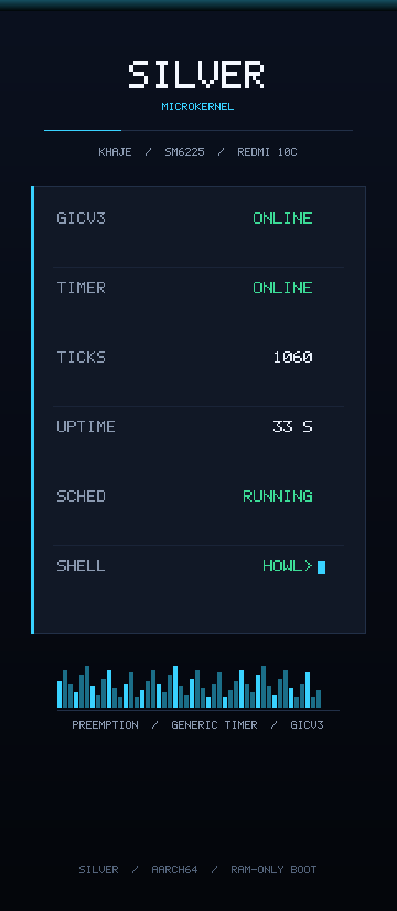
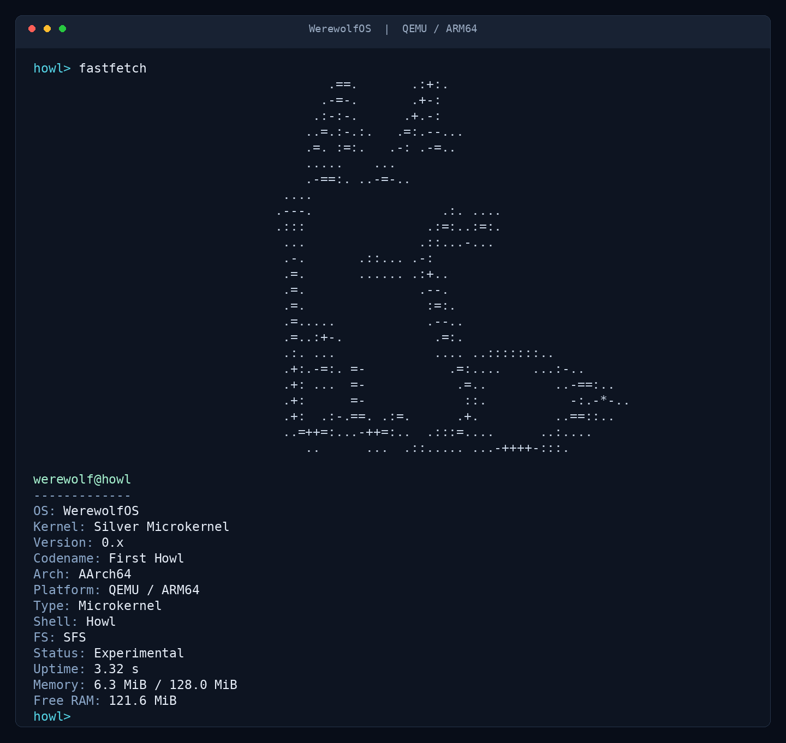

# silver_microkernel

A hobby microkernel for AArch64 (ARM64) written in Rust. The foundation is
bare-metal Rust (`no_std`), with drivers and services in C/C++ planned on top
of it. Cross-platform development: Windows and Linux (Arch) share the same
code — only the build commands and toolchain setup differ.

Primary target: QEMU `virt` machine (ARM Virt Board), Cortex-A72 CPU.
Hardware bring-up target: Xiaomi Redmi 10C (`fog`, Qualcomm SM6225 / khaje),
RAM-only boot. The path is verified on a physical `rain` unit (same
khaje/SM6225 family) up to the scheduler and the Howl task; see
[redmi10c_poc/README.md](redmi10c_poc/README.md).



## Community

🐺 Developer Telegram: [Сильвер не кодит](https://t.me/rustdev_rs)

## Screenshot



The `fastfetch` screen above is real output from WerewolfOS (Silver Microkernel)
running in QEMU. The interactive `howl` shell and the `howler` UART driver run in
userspace.

## What already works

- [x] Bare-metal boot: `_start`, custom linker script, `.bss` zeroing
- [x] PL011 UART console input/output with IRQ-driven RX, echo and line editing
- [x] ARM64 exception vectors: SVC and IRQ trampolines, `panic!` file:line reports, EL0 fault containment
- [x] Physical memory map + page frame allocator (bitmap)
- [x] Kernel heap + Rust global allocator (`alloc`: `Box`, `Vec`)
- [x] GICv2 + ARM Generic Timer (QEMU: IRQ 30, 100 Hz tick) + PL011 RX (INTID 33); runtime GICv3 dispatch for SM8650/fog
- [x] Round-robin scheduler: spawn with numeric/string arguments, `yield`, `sleep`, `kill`, `wait`
- [x] Per-CPU FIFO ready queues: dispatch order is enqueue order (the old stack-shaped queue starved the oldest of three runnable tasks; a boot test fails on the stack version)
- [x] Per-CPU stall watchdog: a PE that stops taking its timer PPI or completing scheduling passes is reported with CPU id and scheduler index; an opt-in `smp-churn` injection proves the detector
- [x] Priority classes with aging: high/normal/low, FIFO inside a class, and a low-class task promoted after two aging windows so continuous high-class work cannot starve it (boot test; disabling aging fails it)
- [x] Push migration: a CPU that still has queued work after a dispatch hands one task to an idle, empty peer without resetting its aging; the dispatch mix reports the `push=` count
- [x] Kernel-lock stall detector: a waiter that cannot take the BKL for one second reports the holder (CPU, depth, current task) once per episode; the boot test proves it, and there is no recovery by design
- [x] Data/instruction caches: after the page tables are published the boot CPU drops the inherited cache state and sets `SCTLR_EL1.C/I`; every AP does the same before touching shared state, each CPU records the value it read back, and the boot test requires `C=1 I=1` on every online CPU (`CACHE=ON line=<n>` in the boot log)
- [x] Console ownership + job control: `bg`/`fg`, Ctrl-Z, `Stopped`, resume and shell recovery
- [x] Lifecycle cleanup: address spaces, mailboxes, file handles, wait queues and owned mutexes
- [x] Blocking mutex with FIFO wait queue, ownership tracking and RAII guard
- [x] Bounded IPC: 16-message mailboxes, blocking send/backpressure and receive timeouts
- [x] IPC cleanup: queued-message disposal and blocked-sender wakeups on receiver exit
- [x] System calls via `svc #0` (number in x8, arguments in x0-x5)
- [x] Nameserver: register/lookup/unregister plus stale-owner cleanup
- [x] Condition variable: per-mailbox wait queues, targeted wakeups and timed waits
- [x] Counting semaphore + bounded channel with backpressure
- [x] MMU: 4-level tables, 4 KB granules, high-half kernel via TTBR1
- [x] Sixteen userspace ELFs with checked `PT_LOAD` loading and BSS zeroing
- [x] Init architecture: `silverd` starts Scout, the block, network, graphics and input drivers, the SFS and network servers, Howl and Howler, all resolved by program ID
- [x] howl: `help`, `fastfetch`, `ls`, `cat`, `echo`, `say`, `sl`, `run`, `mkdir`, `rm`, `rmdir`, `mv`, `cd`, `pwd`, `clear`, `uname`, `ps`, `spawn`, `bg`, `fg`, `kill`, `wait`
- [x] Shell output redirection: `>` truncates, `>>` appends, quoted operators stay literal
- [x] ANSI clear/home and a bold cyan `howl>` prompt
- [x] RAM-VFS: `/bin`, `/etc`, `/tmp`, files/directories and per-task descriptors
- [x] Per-task cwd inherited on spawn, absolute handles and `chdir`/`getcwd` syscalls
- [x] File syscalls: `open`, `read`, `write`, `create`, `close`, `read_dir`, `mkdir`, `unlink`, `rmdir`, `rename`
- [x] Shell syscalls: console ownership, resume, stopped-aware wait, uptime, memory and task info
- [x] Per-task TTBR0 spaces: independent ELF image, fixed-VA stack and private page
- [x] Growable per-task heap: sparse 2 MB window, `brk`, zero-fill and cleanup on exit
- [x] Userspace `malloc/free`: first-fit free list, split, coalesce and `brk` trim
- [x] Userspace `GlobalAlloc`: `Box`, growable `Vec` and deallocation in EL0
- [x] W^X user mappings: R-X text, R-- rodata, RW-NX data/heap/stack/private memory
- [x] No kernel image, kernel data, heap, kernel stacks or unauthorized MMIO in user TTBR0
- [x] Tasks in EL0 (userspace): user stacks and SVC-only kernel access
- [x] Capability-protected kill/wait/console/IRQ/MMIO operations and capability delegation
- [x] Userspace UART driver: IRQ-bound RX plus IPC-routed input and output
- [x] DMA infrastructure: contiguous frames and Normal Non-Cacheable user mappings
- [x] PCI ECAM access plus a Virtio-PCI block driver: modern capabilities, split virtqueue and `read_sector`
- [x] VirtIO-Net driver: modern virtio-pci capabilities, split RX/TX virtqueues, 16 x 2 KiB buffers and MAC discovery
- [x] Shared-memory frame transport: one 8 KiB DMA mailbox, `OP_ATTACH`/`OP_ATTACHED`, `OP_FRAME`/`OP_TX` doorbells, length-word fencing and backpressure
- [x] `net_server`: `smoltcp` in a separate EL0 task with static 10.0.2.15/24 addressing, ARP and IPv4
- [x] ICMP ping end-to-end: `ping <ip>` shell command with strict IPv4 parsing and timeout, verified against 8.8.8.8
- [x] Checked copyin/copyout with permission validation, `LDTR/STTR` and PAN enabled
- [x] EL0 fault containment: bad user accesses kill the task, not the kernel
- [x] EL0 fault triage: `ESR_EL1`/`ELR_EL1`/`FAR_EL1` dump and a 16-entry context-switch trace before the guilty task dies
- [x] High-half and removed-alias probes: both fault without stopping other tasks
- [x] Kernel-stamped IPC senders, checked nameserver IDs, saturating sleep deadlines and release-safe mutex ownership
- [x] Graphics driver: `ramfb` framebuffer through `fw_cfg` DMA, a 640x480 ARGB engineer menu with an 8x8 font
- [x] Input driver: `virtio-tablet-pci` absolute pointer over a virtio event queue, IPC to the graphics driver, live cursor, button press/release and console click notifications (`GUI: Button '<name>' pressed!`)
- [x] Dynamic ELF loader: `run <path>` loads an ELF64 file from the VFS into a fresh EL0 task with its own W^X address space
- [x] EL0 fault containment: a crashed EL0 task (e.g. `run bin/crash`) is killed with a `Task X killed: Page Fault` log and the shell keeps running
- [x] Power off: the GPU "Power" button shuts QEMU down via PSCI `SYSTEM_OFF`
- [x] Redmi 10C (`fog`, SM6225) RAM-only path: live-FDT probe, memory planner, GENI UART, GICv3/timer selection and fail-closed relocation with pre-copy FDT destination validation (QEMU-verified, and booted on a physical `rain` unit)
- [x] Real Redmi 10C boot: RAM-only `fastboot boot` reaches the scheduler and the Howl task, with live GICv3 timer interrupts (verified on a `rain` unit)
- [x] Boot-time MMU TLB proof: read through TTBR0, remap the same VA, read again (fails the boot if the `tlbi` broadcast is missing)
- [x] Per-task anonymous-mapping quota (16 MiB) and a DMA quarantine window before revoked frames are recycled
- [ ] SFS write path, block-path interrupts, remaining resource quotas and persistent storage
- [ ] SMP (`-smp 4`): **QEMU-only, opt-in** — see `SMP_STATUS.md`. `no_std,smp` brings up to three APs online (CPU1–CPU3), runs tasks on every CPU and passes the `demo-tasks` regression on `-smp 4` (66 PASS / 0 PANIC). Dispatch uses per-CPU FIFO ready queues (local queue → steal from a peer → full-scan fallback), with entries carrying `(id, index)` so an index shift can only discard an entry. Every address space carries a unique 8-bit ASID, so a context switch no longer flushes the domain-wide TLB and a PTE edit invalidates only the edited ASID. `no_std,smp-selftest` additionally runs a cross-PE TLB probe (every AP reads a VA, the boot CPU re-points the same PTE, every AP must observe the new frame), 64 back-to-back SGI1 stop-the-world rounds, a per-CPU timer-tick check, a `running_on`/`current_index` pairing check on every scheduling pass, a FIFO-order probe, a priority/aging probe, a push-migration probe, the BKL stall detector, the stall-watchdog policy and heartbeat checks, and a one-shot `ready queues local/steal/scan/push` report. An opt-in `smp-churn` diagnostic spawns short-lived kernel tasks while the APs run/reap them, with the per-pass invariant audit active; it found and now regression-tests three scheduler bugs (preemptible passes, kernel-task lock imbalance, IRQ window in lock acquisition). It also injects a real masked-IRQ stall and requires another PE to report it (`watchdog stall PASS`). It stays opt-in because it is a stress/injection suite, not a correctness prerequisite; both parts pass on `-smp 2`, `-smp 3` and `-smp 4`. Console writes are serialized across CPUs; whole-line interleaving at call boundaries is still possible. Device-DMA quiescence is enforced for in-kernel `DmaLease` holders (a live lease makes revoke leak instead of reuse); userspace drivers still rely on the quarantine window. Physical SMP and in-flight-MMAP stress remain unverified; fog/tablet stay single-core. Do not boot on hardware expecting SMP.

## Design references

This kernel is not a port of another OS. Two systems are used as **conceptual**
references, not as source:

- **XNU (aarch64)** — `pmap`-style batched page-table publication with a single
  shootdown, quiescence before frame reclamation, per-CPU scheduler state and a
  global lock where the fast path is not yet split.
- **Redox (Rust)** — ownership-based lifetimes for wait queues (`Arc`), typed
  capability tables, and explicit lock-scope/ordering documentation.

Where a reference design conflicts with this kernel's microkernel boundaries,
capability model or hardware profiles, the kernel's own invariants and tests
win. No XNU or Redox code is copied.

## Redmi 10C (`fog`, SM6225) — RAM-only bring-up

Status as of 2026-11-03 (TASK №19–№23). The authoritative port document is
[redmi10c_poc/README.md](redmi10c_poc/README.md).

Implemented:

- [x] Separate `fog` platform kind and `linker_fog.ld` (DRAM base `0x4000_0000`,
      link slot `0x4008_0000`)
- [x] ARM64 Image header, hand-over capture (`x0` DTB, `CurrentEL`, `SCTLR_EL1`,
      `MPIDR_EL1`, actual PC) and a fixed-layout `BOOT_PARAMS` record
- [x] Allocation-free FDT parser plus a memory planner that subtracts
      `/memory`, `/reserved-memory`, the memreserve map, the loaded image and
      the DTB
- [x] Live khaje/SM6225 probe; compile-time addresses are fallbacks, not
      asserted hardware facts
- [x] GENI UART TX/polled RX and runtime GICv3/timer/UART INTID selection
- [x] GICv3 redistributor lookup by `GICR_TYPER` affinity, with no frame-0
      fallback; the timer is not armed when no redistributor matches
- [x] Fog scheduler path: idle, Scout and Howl; Howl falls back to `SYS_READ`
- [x] **Fail-closed relocation by default.** A standard `fog` build never
      copies the image. If ABL enters it at anything other than the link
      address, it records `pc`/`link`/`delta` in `BOOT_PARAMS` and parks.
- [x] Opt-in `fog-reloc` feature for controlled experiments. Before copying it
      validates the ARM64 header, image size, both source and destination span
      ends, overflow and every overlap, **and** reads the live FDT to prove the
      destination is inside `/memory` and outside every reservation,
      memreserve, the DTB and the running source image. Unknown cell layouts,
      non-empty `/reserved-memory` `ranges` and malformed trees fail closed.
- [x] RAM-only boot image v3 builder (builds only; never flashes or runs a
      device command)
- [x] Real-device boot on a Redmi 10C `rain` unit: `fastboot boot` reaches the
      scheduler and the Howl task, with live GICv3 timer interrupts

The default fog image is intentionally conservative: it will not write outside
its own loaded image when the placement is unexpected. `fog-reloc` now performs
the pre-copy live-FDT proof, but it remains an opt-in experiment: the check is
deliberately conservative (2/2 cells, no `ranges` translation), and no real
device has been booted with it yet.

```bash
# Kernel (default, fail-closed)
cargo build --release --target aarch64-unknown-none \
    --no-default-features --features no_std,fog

# QEMU-only SMP (up to 4 CPUs; run QEMU with -smp 4): APs online,
# GIC/timer/IPI and task execution on every PE
cargo build --release --target aarch64-unknown-none \
    --no-default-features --features no_std,smp

# Same, plus 64 boot-time SGI1 stop-the-world rounds and a per-CPU timer check
cargo build --release --target aarch64-unknown-none \
    --no-default-features --features no_std,smp-selftest

# Explicit relocation experiment (only after proving the destination)
cargo build --release --target aarch64-unknown-none \
    --no-default-features --features no_std,fog,fog-reloc

# QEMU integration: relocation, at-link boot and fail-closed park
redmi10c_poc/test_fog_qemu.sh

# Boot image v3 (build only, no device operation)
redmi10c_poc/build_boot_image.sh
```

QEMU validates only the Silver-side logic (FDT, planner, relocation policy,
GICv3/timer and the Howl path). It does **not** prove GENI, khaje GIC/timer,
the live memory map or the ABL load address on a real unit.

## Phase 4: Network — complete

The network stack works end-to-end and is driven from the shell. Working: the
VirtIO-Net driver, the userspace `smoltcp` server, shared-memory IPC over a DMA
mailbox, and a `ping <ip>` command with strict IPv4 validation and a timeout.

```text
howl> ping 8.8.8.8
PING 8.8.8.8:  OK
```

The reply has crossed the NIC, both virtio queues, the DMA mailbox in both
directions, smoltcp's ARP and IPv4/ICMP layers, and the checksum check. Any
IPv4 address can be pinged — not only the slirp gateway — and success is
reported only on a matching echo reply before the timeout.

## Phase 5: Graphics and input — complete

The graphics and input path works end-to-end. `gpu_driver` paints a static
"engineer menu" (BIOS / iPhone Field-Test style) onto a `ramfb` framebuffer, and
`input_driver` drives the `virtio-tablet-pci` mouse into a live cursor that
presses and releases the menu buttons.

`ramfb` (not PL111, which the `virt` machine does not have) is QEMU's plain-RAM
framebuffer: the guest allocates a contiguous 640x480 ARGB frame buffer with
`SYS_ALLOC_DMA`, writes a big-endian `RAMFBCfg` descriptor to the `etc/ramfb`
`fw_cfg` file through the `fw_cfg` DMA interface (`0x09020000`), and then paints
pixels directly into the RAM. `input_driver` finds the modern-only
`virtio-tablet-pci` (`1af4:1052`) device, provides 64 x 8-byte
`virtio_input_event` buffers on its event queue, and on every `EV_SYN` scales the
absolute `0..32767` coordinates to 640x480 and sends one `InputMsg` to
`gpu_driver` (resolved by name through the nameserver).

The menu draws three grey status cells ("Num", "No Data", "Date"), a 3x2 grid of
blue buttons ("Phone", "SMS", "Web", "Media", "Power", "Settings") and a bottom
panel ("SN: 877...", "Silver Microkernel v0.1"). Moving the mouse repaints the
frame with a white arrow cursor on top; holding a button fills it dark blue
(`0x003366`) and releasing restores the normal blue.

```bash
./build_and_qemu.sh release   # opens a GTK window (ramfb + tablet, show-cursor)
```

The script now passes `-device ramfb -device virtio-tablet-pci,disable-legacy=on`
and `-display gtk,show-cursor=on` (the shell stays multiplexed on stdio via
`-serial mon:stdio`). To run headless, substitute `-display vnc=...` and drive
the mouse with QMP `input-send-event`.

## Phase 6: Dynamic ELF loader — complete

The kernel can now load an ELF64 binary from the RAM-VFS into a fresh EL0
task — the binary no longer has to be embedded at build time. `src/elf.rs`
parses the header and program table (`load_elf -> LoadedImage { physical_start,
page_count, entry, kinds }`), allocates a frame per `PT_LOAD` page, copies file
bytes, zero-fills BSS and enforces W^X with per-page `PageKind` permissions
(Text R-X, ReadOnly R--, Data RW).

```text
howl> run bin/hello
Spawning ELF at 0x0000000040000000 with stack at 0x000000007FE00000
Hello from ELF!
```

The path is: `run <path>` in the shell → `SYS_SPAWN_PATH` (the kernel reads the
file by path, since the ELF is far larger than the 4 KiB copyin limit) →
`elf::load_elf` → `spawn_elf`, which builds TTBR0, maps the image and the user
stack (`0x7FE0_0000`, 2 pages), sets the entry point and returns a capability
handle so the shell can lend the console and wait. The new task starts with an
empty capability table — any device rights must be delegated by its parent. A
dynamically loaded task shows up in `ps` as `elf` (`PROGRAM_DYNAMIC =
u64::MAX - 1`).

`/bin/hello` is seeded into the VFS at boot from the build artefact
(`src/seed.rs`, `include_bytes!(OUT_DIR/hello.elf)`). `hello.elf` is built by
`build.rs` like every other binary but deliberately omitted from the embedded
program table, so `run bin/hello` is the only way to execute it — proving the
loader path end-to-end. The embedded `spawn` path is unchanged and shares the
same `elf::load_elf` (via the thin `elf_loader` shim).

## Phase 7: EL0 fault containment + teardown — complete

An EL0 task that faults is killed cleanly and the kernel keeps running. The
sync-exception vector routes EL0 faults (bad pointer, privileged MSR, EL1-only
MMIO) to `silver_handle_task_fault`, which logs `Task <id> killed: Page Fault at
0x... (ESR: 0x...)` and kills only that task; its kernel stack, user stack,
TTBR0 page tables and ELF image frames are all released on teardown. An EL1
exception, in contrast, is a kernel bug: `silver_handle_exception` dumps the
registers and halts in a `wfe` loop.

`bin/crash` is a test program (seeded alongside `bin/hello`) that writes to
`0x0` to exercise the path deterministically:

```text
howl> run bin/crash
crash: writing to 0x0...
Task 11 killed: Page Fault at 0x0000000000000000 (ESR: 0x0000000092000045)
howl> ps      # task 11 is gone; the shell and all drivers are still live
```

After the fault the shell returns to the prompt and `run bin/hello` still works.

## Power off — complete

The "Power" button on the engineer menu shuts the machine down. `gpu_driver`
calls `syscall::power_off()` on release; the kernel's `SYS_POWER_OFF` (71) then
issues PSCI `SYSTEM_OFF` (`0x8400_0008`) through `hvc #0` — the HVC conduit,
because QEMU `virt` boots the guest at EL2 with no EL3 (an `smc` there would trap
as an EL1 exception). QEMU prints "Power down" and exits; the serial shows
`POWER OFF: PSCI SYSTEM_OFF` first.

## Requirements

- Rust stable with the `aarch64-unknown-none` target
- QEMU with AArch64 system emulation

### Windows

```bash
# Rust + target
rustup target add aarch64-unknown-none

# QEMU: installer from https://www.qemu.org/download/#windows
# (path below is the installer's default)
```

### Arch Linux

```bash
sudo pacman -S qemu-system-aarch64 rustup
rustup target add aarch64-unknown-none
```

For the fog QEMU test and RAM-only image build, also install `dtc`,
`llvm-objcopy` (or `aarch64-linux-gnu-objcopy`) and AOSP `mkbootimg`
(`android-tools`). The boot-image script only builds; it never flashes.

## Build and run

Windows (Git Bash), interactive shell:

```bash
export PATH="$(cygpath -u "$USERPROFILE")/.cargo/bin:$PATH"
cd "F:/My Projects/Silver microkernel"
cargo build --target aarch64-unknown-none --no-default-features --features no_std
"/c/Program Files/qemu/qemu-system-aarch64.exe" \
  -machine virt -cpu cortex-a72 -m 128M -nographic \
  -kernel target/aarch64-unknown-none/debug/silver_microkernel
```

Linux, interactive shell:

```bash
cargo build --target aarch64-unknown-none --no-default-features --features no_std
qemu-system-aarch64 \
  -machine virt -cpu cortex-a72 -m 128M -nographic \
  -kernel target/aarch64-unknown-none/debug/silver_microkernel
```

Linux, one-shot with the SFS disk attached (what `sfs_server` needs):

```bash
./build_and_qemu.sh            # release build + QEMU with disk.img via virtio-blk-pci
./build_and_qemu.sh debug      # same, debug build
./build_and_qemu.sh --no-run   # build only
```

The script attaches `disk.img` (SFS-formatted with `format_sfs.py`) as a
`virtio-blk-pci` device; without it the block driver reports "not
initialized" and the filesystem server exits with a stage-coded status.
Exit code diagnostics: the kernel prints `EXIT: task=… program=… status=…`
(0x…) for every exiting task; for `sfs_server` the status low byte names the
mount stage and bits 40-47 the block driver's init stage.

At the `howl>` prompt, `help` lists all commands. Backspace edits the
current line. A minimal file workflow looks like this:

```text
howl> ls
bin/
etc/
tmp/
howl> echo 'hello' > test.txt
howl> cat test.txt
hello
howl> echo 'again' >> test.txt
howl> cat test.txt
hello
again
howl> mkdir docs
howl> mv test.txt docs/readme.txt
howl> cat docs/readme.txt
hello
howl> rm docs/readme.txt
howl> rmdir docs
howl> cd /bin
howl> pwd
/bin
howl> ls
```

`ls`, `cat` and ordinary `echo` run as separate EL0 programs; they inherit the
shell's cwd, temporarily receive the console and return it when the shell has
consumed their exit status. Redirection, `mkdir`, `rm`, `rmdir`, `mv`, `cd` and
`pwd` use syscalls directly.

`spawn demo 12` and `bg demo 12` start a background task without console access.
`spawn` prints the child's Task ID and CapId. `fg <cap>` transfers the console
and waits; Ctrl-Z stops the foreground task and returns the shell prompt;
another `fg <cap>` resumes it. `kill <cap>` and `wait <cap>` require the
corresponding capability rights.

During normal boot, Howler owns PL011 in EL0: hardware IRQ 33 wakes the driver,
and input/output travel through IPC. The kernel retains a bounded RX fallback
for early diagnostics, demo tasks and recovery if Howler dies. The output sink is
resolved at runtime from the task bound to INTID 33, so console routing survives
any spawn order (`spawn block_driver` reusing Howler's old task ID cannot capture
the shell output).

`diskread [sector]` and `hexdump [sector]` talk to the block driver over IPC and
read real sectors from the attached `virtio-blk-pci` disk. Like the console sink,
the driver is found by program ID through `SYS_TASK_LIST`, never by a fixed task
number, and a request is bounded by a reply timeout. Killing or crashing the
driver therefore prints an error and returns the prompt; the kernel and the shell
keep running.

Press `Ctrl-A`, then `X`, to quit QEMU. For an unattended smoke test,
prefix QEMU with `timeout 5s`; exit code 124 then means the kernel stayed alive.

`Cargo.toml` has `std` (default host stub), `no_std` (bare metal), `smp`
(opt-in QEMU SMP, up to 4 CPUs), `smp-selftest` (SMP plus 64 boot-time SGI1
quiescence rounds, a cross-CPU visibility check and a per-CPU timer check),
`demo-tasks` (opt-in regression programs), `tablet` (SM8650), `fog`
(SM6225 RAM-only bring-up) and `fog-reloc` (explicit opt-in for the fog
self-relocation copy). Normal bare-metal boot starts only
silverd, which then starts Scout, the block driver, the network driver, the SFS
server, the network server, the graphics and input drivers, Howl and Howler in
that order. No component depends
on the resulting numbers: the console sink, Howler, the block driver and both
network tasks are looked up by program ID at runtime, and the block and network
drivers also answer the sender of each request. To run
the fault/VM/allocator/IPC regression programs instead, use
`--features no_std,demo-tasks`. `build.rs` automatically builds and embeds every
userspace ELF; no separate userspace command is needed.

## Network

`net_driver` owns the VirtIO-Net PCI function; `net_server` runs `smoltcp` in
its own EL0 task. An Ethernet frame does not fit in the 32-byte IPC message, so
the server allocates one 8 KiB DMA window and the two tasks exchange only
doorbells; frame bytes travel through the shared window.

| Offset | Contents |
| --- | --- |
| `0x000` | `u32` RX length, written by the driver |
| `0x004` | `u32` TX length, written by the server |
| `0x800` | `MAX_FRAME` (1536) bytes, driver -> server |
| `0x1000` | `MAX_FRAME` (1536) bytes, server -> driver |

| Opcode | Direction | Meaning |
| --- | --- | --- |
| `OP_ATTACH` (1) | server -> driver | publish the DMA physical address and size |
| `OP_ATTACHED` (2) | driver -> server | window mapped; carries the NIC MAC |
| `OP_FRAME` (3) | driver -> server | a received frame is in the RX slot |
| `OP_TX` (4) | server -> driver | a frame to transmit is in the TX slot |
| `OP_PING` (5) | shell -> server | request one ICMP echo; `payload[1..5]` is the IPv4 address |
| `OP_PING_REPLY` (6) | server -> shell | `payload[1]` is success, `payload[2..6]` echoes the address |

The driver maps the window with `SYS_MAP_PHYS` (Normal Non-Cacheable), polls
virtio RX on every IPC loop (10 ms idle timeout), and moves at most one frame in
each direction. A producer writes the payload, executes `dmb ish`, then
publishes the length; a consumer reads the length, executes `dmb ish`, copies,
then clears it. The server publishes TX only when the slot is free, so a slow
driver cannot cause the server to overwrite a frame in flight. TX doorbells are
accepted only from the server task that owns the window.

`net_server` uses the MAC from `OP_ATTACHED` and configures `10.0.2.15/24` with
default gateway `10.0.2.2`. It no longer pings at boot; instead it waits for an
`OP_PING` from the shell, queues one ICMPv4 echo request, and answers
`OP_PING_REPLY` with the outcome. smoltcp resolves the gateway (or any routed
neighbor) with ARP and keeps the echo queued until that neighbor is usable.
QEMU user-mode networking answers ARP and the echo, so `ping 8.8.8.8` exercises
TX, RX, ARP, IPv4 and ICMP checksum verification in one path. Because
`net_server` does not own the console, it relays the result to `howl`, which
prints the human-readable `PING <ip>: OK` (or `TIMEOUT`).

`build_and_qemu.sh` relies on QEMU's implicit default `virtio-net-pci` on the
`virt` machine; no explicit network device is needed. The current limitations
are deliberate: IPv4 only, a static address and gateway, one frame slot per
direction, no virtio-net interrupts (RX is polled), and no TCP/UDP services,
DHCP or DNS. The driver assigns its 64 KiB BAR window at `0x1020_0000`; this
assumes the block driver keeps `0x1010_0000`. Both tasks are visible in `ps`.

## Project layout

| File | Purpose |
| --- | --- |
| `build.rs` | Builds and embeds the userspace ELFs; also copies `hello.elf` for the VFS seed |
| `src/main.rs` | Physical boot entry, hand-over capture, fog placement policy, high-half transition, exception trampolines |
| `src/boot.rs` | `BOOT_PARAMS` / `BOOT_CLAIM` layout shared with the assembly stub |
| `src/exceptions.rs` | EL0 fault register dump, switch trace and the kernel exit path |
| `src/pl011.rs` | Kernel UART diagnostics and bounded RX fallback |
| `src/memory.rs` | Physical memory map and high-half address conversion; fog DRAM window |
| `src/fdt.rs` | Allocation-free FDT parser and fog boot-memory planner |
| `src/fog.rs` | khaje/SM6225 probe, live FDT policy, memory window and banner |
| `src/fog_validate.rs` | Pre-relocation live-FDT destination proof (no allocation, no statics) |
| `src/geni_uart.rs` | Qualcomm GENI SE UART TX/polled RX driver |
| `src/gicv3.rs` | Runtime GICv3 distributor/redistributor setup and IRQ dispatch |
| `src/gicv3_policy.rs` | Host-tested GICR_TYPER affinity matching |
| `src/reloc.rs` | Host-tested fail-closed self-relocation boundary policy |
| `src/platform.rs` | Runtime `Kind::{Qemu,Sm8650,Fog,Unknown}` identity |
| `linker_fog.ld` | Fog high-half VMA and `0x4008_0000` link slot |
| `src/frame_allocator.rs` | Physical page frame allocator (bitmap) |
| `src/allocator.rs` | Kernel heap, `#[global_allocator]` |
| `src/gic.rs` | GICv2 setup plus runtime dispatch to GICv3; timer availability gate |
| `src/timer.rs` | ARM Generic Timer, tick counter |
| `src/interrupts.rs` | IRQ control: masking/restoring DAIF |
| `src/capability.rs` | Capability tables, rights, delegation and revocation |
| `src/scheduler.rs` | Tasks, capabilities, DMA ownership, console control and reaping |
| `src/mutex.rs` | Blocking mutex with FIFO waiters and ownership tracking |
| `src/wait_queue.rs` | Shared FIFO queue with dead-waiter removal |
| `src/ipc.rs` | Bounded mailboxes, backpressure, timed/selective receive and cleanup |
| `src/syscall.rs` | System call table and checked user-buffer operations |
| `src/user_memory.rs` | PAN-compatible `LDTR/STTR` copyin/copyout |
| `src/condvar.rs` | Condition variable: timed/infinite wait and targeted wakeups |
| `src/semaphore.rs` | Counting semaphore on mutex + condvar |
| `src/channel.rs` | Bounded channel: two semaphores + a mutex (backpressure) |
| `src/mmu.rs` | TTBR1 kernel map, per-task TTBR0 maps, permission validation |
| `src/elf_loader.rs` | Thin shim over `elf::load_elf` for embedded images |
| `src/elf.rs` | Dynamic ELF64/AArch64 `PT_LOAD` loader, `LoadedImage`, `PageKind`, `ElfError` |
| `src/user_program.rs` | Program IDs and embedded userspace ELF selection |
| `src/vfs.rs` | RAM file tree, normalized paths and per-task file descriptors |
| `src/seed.rs` | Boot-time VFS seeding of `/bin/hello` for the dynamic loader |
| `userspace/src/allocator.rs` | Per-task first-fit `malloc/free` over `SYS_BRK` |
| `userspace/src/bin/silvershell.rs` | Interactive shell and `logo.txt` fastfetch screen |
| `userspace/src/bin/net_driver.rs` | VirtIO-Net driver, split virtqueues and frame mailbox |
| `userspace/src/bin/net_server.rs` | `smoltcp` TCP/IP stack and ICMP echo |
| `userspace/src/net_ipc.rs` | Shared-memory frame protocol used by both network tasks |
| `userspace/src/bin/gpu_driver.rs` | ramfb framebuffer, engineer menu, cursor and button UI |
| `userspace/src/bin/input_driver.rs` | virtio-tablet absolute-pointer driver |
| `userspace/src/input_proto.rs` | Pointer-sample IPC shared by the input and graphics drivers |
| `userspace/src/bin/{ls,cat,echo}.rs` | Separate EL0 file/console utilities |
| `userspace/src/bin/hello.rs` | Test program loaded dynamically via `run bin/hello` |
| `userspace/src/bin/crash.rs` | Fault-containment test: writes to `0x0`, run via `run bin/crash` |
| `userspace/` | Separate demo, nameserver, shell and utility EL0 programs |
| `redmi10c_poc/README.md` | Authoritative Redmi 10C (fog) bring-up document |
| `redmi10c_poc/test_fog_qemu.sh` | Fog QEMU relocation/at-link/fail-closed regression |
| `redmi10c_poc/build_boot_image.sh` | RAM-only Android boot image v3 builder (no device operation) |
| `.cargo/config.toml` | Target, rust-lld linker, `-Tlinker.ld` flag |

## Memory model

The kernel is linked at high virtual addresses but loaded at low physical
addresses. The assembly boot stub builds temporary low/high aliases, enables
the MMU, branches to the high PC, and removes the kernel's low identity map.

```text
TTBR1 (EL1 only):  0xFFFF000000000000 + PA -> kernel image, heap, stacks, MMIO
TTBR0 (per task): own ELF + sparse heap + own fixed-VA stack + private page
```

The fog build links against `linker_fog.ld` (`__dram_base = 0x4000_0000`,
`__kernel_link_pa = 0x4008_0000`). Its first PoC maps exactly the first DRAM
gigabyte (`0x4000_0000..0x8000_0000`); a larger live bank is clipped out of the
allocator window rather than assumed safe. The standalone `fog` build does not
self-relocate: a non-link entry publishes the measured placement and parks. The
`fog-reloc` feature enables the checked copy path for controlled experiments.

The scheduler changes only TTBR0_EL1 and flushes stale TLB entries. Its EL1
code and SP_EL1 stack remain mapped through TTBR1_EL1. Every user task gets
an independently loaded ELF image at `0x40000000`, an 8 KB stack at
`0x7FE00000`, and a private 4 KB page at `0x0000_0080_0000_0000`. Equal VAs
in different tasks have different physical backing. VM A/B verify the private
page, ELF BSS and heap by reading back only their own values.

Page tables are owned by the address space that created them. Each table frame
is registered with its allocation generation and root owner; every walk checks
the owner of the root and of each level before reading or editing a descriptor.
A descriptor that points at another space's table is a hard refusal, not a
dereference. Teardown drains a space by its root token and validates the token
before removing anything, so a stale token leaks rather than freeing a recycled
frame.

Mapping and `SYS_BRK` growth publish a whole range before one barrier: each
touched descriptor's cache line is cleaned as it is written, then a single
`dsb ishst` + broadcast `tlbi vmalle1is` + `dsb ish` completes the batch. A
16-page DMA map or a several-hundred-page heap growth therefore pays one
shootdown, not one per page. The boot TLB self-test reads through a remapped
TTBR0 VA, so a missing invalidation fails the boot; the opt-in `smp-selftest`
cross-PE probe additionally requires a peer CPU to observe the remap through
the broadcast.

Each address space owns a unique 8-bit ASID in `TTBR0_EL1[63:48]` (`ASID 0` is
the boot/kernel value). A context switch only writes TTBR0 and executes `isb`:
both spaces' translations stay cached under their own tags. Table edits use
`tlbi aside1is` for the edited ASID, and a destroyed space's ASID is
broadcast-invalidated before it returns to the 255-entry pool. The boot
`MMU ASID` test maps the same VA in two spaces, switches without any flush and
requires each space to read its own frame.

Unmap and reclamation are fail-closed. A partial `munmap` is refused without
touching the mapped part; if a backing run cannot be proven fully unmapped it is
leaked (`MMAP_LEAKED_FRAMES`) instead of being handed to a new owner. DMA frames
are freed only after every live address space has been scanned and
`safe_to_free` is true; otherwise they are leaked (`DMA_LEAKED_FRAMES`). An
in-kernel driver that holds a `DmaLease` for a range keeps it out of the free
path even when the CPU scan is clean: a live lease means the device may still
write. The lease is the kernel-visible half of the device stop/reset contract.
`safe_to_free` covers CPU mappings only: without an IOMMU it does not prove that
a device has stopped DMA. A driver must stop or reset its queue and observe
completion before it exits.

DMA buffers are mapped Normal Non-Cacheable. The initial publication cleans the
cacheable kernel alias to the point of coherency before user or device access;
afterwards every participant must use only the Non-Cacheable alias. Shared-DMA
physical addresses are bearer capabilities, and the IPC protocol that hands one
out is responsible for granting it. Cache maintenance ranges use
`CTR_EL0.DminLine`, not a fixed 64-byte assumption.

`SYS_BRK` manages a byte-granular program break in a reserved 2 MB heap window
at `0x40200000`. Growth maps zeroed RW-NX pages on demand; shrinking unmaps and
frees whole pages; failed growth rolls back partial mappings. Reaping frees
all remaining heap frames.

`userspace/src/allocator.rs` provides explicit 16-byte-aligned `malloc/free`.
It uses first-fit, splits large free blocks, keeps the list address-sorted and
coalesces adjacent blocks. Freeing a tail block also shrinks `brk`, returning
whole pages to the kernel. Tests verify same-address reuse, neighbor integrity
and restoration of the initial program break.

The demo ELF registers this allocator as `#[global_allocator]`, so `Box`, `Vec`
and default `GlobalAlloc` reallocation work in EL0. Layouts requiring alignment
above 16 bytes and OOM terminate only the current task with diagnostics. The
EL0 test grows a 32-element `Vec`, checks `Box::new(42)` and verifies `brk` trim
after both values are dropped.

The userspace linker emits separate R-X, R-- and RW `PT_LOAD` segments. The
loader accepts static ELF64/AArch64 `ET_EXEC` files inside a 2 MB image window,
rejects W+X or incompatible page permissions, copies file bytes into fresh
frames and zero-fills BSS. There is no shared kernel `.text` / `.rodata` alias
left in TTBR0.

All demo tasks except idle run at EL0t and enter the kernel only through
`svc #0`. Copyin/copyout validates mapping and read/write permissions through
the current TTBR0, then uses unprivileged `LDTRB/STTRB` while SCTLR.PAN is
enabled. Read-only and unmapped output buffers are rejected before a receive
can block.

Two intentional probes prove isolation: task 15 reads
`0xFFFF000040000000` (high-half kernel) and task 16 reads
`0x0000000040080000` (the old kernel text alias). Each must produce one
`Task <id> killed: Page Fault at 0x... (ESR: 0x...)` block (`ESR_EL1` / `ELR_EL1`
and the switch trace; `ESR_EL1 >> 26 = 0x24`, a data abort from EL0); all other
tasks continue running.

`spawn(program, argument)` selects a registered ELF and passes a numeric argument
to its entry point. `spawn_with_args` additionally copies a bounded byte string
for `SYS_ARGS`. `kill` rejects idle/self and terminates another task with status
1. `wait(id)` blocks until termination and consumes a bounded completion record,
so it also works after the task's memory has been reaped. The lifecycle demo
proves that reaping releases resources. Nameserver RPC uses selective receive
so unrelated messages cannot be consumed as lookup responses.

The RAM-VFS starts with `/bin`, `/etc` and `/tmp`. Each task owns an absolute
cwd and children inherit it on spawn. Relative paths resolve from that cwd;
`.` and `..` are normalized without escaping root. `SYS_CHDIR` validates the
target directory and `SYS_GETCWD` copies the absolute cwd to userspace. Open
handles retain absolute paths, so later `cd` calls do not change their target.
Files are volatile and live in kernel heap memory. Descriptors start at 3,
belong to one task, track their offset and close automatically on exit or kill.
Path and I/O buffers are bounded and all user pointers pass checked copying.
`create` truncates an existing file; `mkdir` rejects duplicates. `OPEN_APPEND`
requires write mode and moves every write to the current EOF. `unlink` refuses
files that still have open descriptors (there is no Unix-style unlink-while-open
yet). `rmdir` accepts only empty directories and rejects root or any directory
that contains a live task's cwd. `rename`/`mv` never replaces an existing node,
rejects self/subtree moves and pins sources with open files or active directory
cwds.

Each mailbox holds at most 16 messages. A sender blocks on `not_full` while the
queue is full; removing any message wakes one sender. `SYS_RECEIVE(buffer, ticks)`
uses `0` for polling, `u64::MAX` for infinite waiting and any other value as a
relative timer-tick timeout. It returns `SYSCALL_TIMEOUT` (`u64::MAX - 1`) on
expiry. Receiver exit clears queued messages, wakes all blocked senders and makes
their sends fail instead of recreating the dead mailbox. Demos verify timeout,
backpressure on the seventeenth send, FIFO delivery and exit wakeup.

## Security notes

The kernel stamps every IPC sender after checked copyin, rejects non-owner mutex
unlock in all build profiles, parses nameserver IDs with checked arithmetic and
uses saturating sleep deadlines. Debug and release regression probes cover these
paths alongside the existing MMU, copyout, lifecycle and IPC checks.

This is not yet a complete security model. Kill, wait, console, resume, MMIO,
IRQ and PCI operations check capability rights; `SYS_CAP_GRANT` delegates only a
subset of the caller's rights, and task death revokes or downgrades affected
capabilities. Page-table walks are owner-checked and DMA revocation is bounded
to DRAM, so a corrupted descriptor cannot redirect a walk into a foreign table
or below `DRAM_BASE`. Anonymous mappings are capped per task (16 MiB) so one
EL0 task cannot claim the whole machine, and VFS, open-file, DMA-window, task
and capability counts have explicit bounds; heap and wait-queue growth still
lack a per-task quota, so denial-of-service resistance remains incomplete.
A shared-DMA physical address is a bearer capability. `safe_to_free` proves
only that CPU mappings are gone; revoked ranges are additionally quarantined
for a bounded drain window, but that is a mitigation rather than a
device-quiescence proof — stopping the queue remains the driver's contract.

## Documentation

| Document | Contents |
| --- | --- |
| [redmi10c_poc/README.md](redmi10c_poc/README.md) | Authoritative Redmi 10C / fog bring-up: design, live-FDT policy, fail-closed relocation, QEMU tests, unconfirmed hardware parameters |
| [SMP_STATUS.md](SMP_STATUS.md) | SMP: QEMU bring-up of up to four CPUs behind the `smp` feature, round-qualified quiescence, FIFO ready queues, per-CPU timer checks, a stall watchdog and boot selftests; true cross-PE TLB stress and physical SMP are not verified |
| [handoff.md](handoff.md) | Architecture invariants, technical debt, historical checkpoints and next steps |

Current verification snapshot (2026-11-05): **171 host tests** pass; the fog
QEMU suite covers relocation, at-link boot, default fail-closed park and an
FDT-reserved-destination rejection; normal QEMU release and debug builds reach
`howl>`; the demo regression reports 66 PASS / 0 PANIC under `no_std,smp` with
QEMU `-smp 4` (and `-smp 2`); the `no_std`, `fog`, `fog-reloc`, `tablet`,
`smp`, `smp-selftest`, `smp-churn` and `demo-tasks` configurations all build;
the opt-in `smp-churn` profile passes `churn PASS`, `push PASS`,
`watchdog stall PASS`, `bkl stall PASS` and `priority PASS` on `-smp 2`,
`-smp 3` and `-smp 4` with the per-pass invariant audit active. Caches are on
in every console-capable profile (`CACHE=ON line=64`) and
`SMP SELFTEST: cache PASS (4 CPU(s) C=1 I=1)` joins the combined
`demo-tasks,smp-selftest` run at **77 PASS / 0 FAIL / 0 PANIC**. QEMU does not
model caches, so the cross-alias DMA coherence probe in `DMA ZERO OK` is a
real-hardware check; the `SCTLR_EL1` read-back is the discriminating test in
emulation. The opt-in
`no_std,smp` build on QEMU `-smp 4` brings CPU1–CPU3 online, runs tasks on
all four CPUs, and reaches a working `howl>` prompt; slots the machine does
not expose stay offline instead of aborting bring-up. DMA teardown stops the
other CPUs with a round-qualified SGI1 acknowledgement handshake; a timeout
falls back to the conservative quiescence gate (a space still current on a
CPU is not destroyed, and a range mapped by a running task is deferred and
leaked). Revoked DMA runs are quarantined for several scheduling epochs before
their frames return to the allocator, and a boot self-test proves the window.
Global time is derived from the always-on system counter (`CNTPCT_EL0`)
relative to the value captured at timer init, so `sleep`/IPC deadlines are one
monotonic clock for every PE and keep advancing while a CPU is in a long
IRQ-masked section; the boot test `clock PASS (CPU0 masked, ticks +N)` masks
the boot CPU and fails on the old boot-CPU-only counter. The opt-in
`no_std,smp-selftest` run executes 64 back-to-back rounds, proves per-round
memory visibility across CPUs, and verifies that every online PE advances its
own timer tick (`ticks PASS (3 peer CPU(s))` on `-smp 4`). A
separate boot self-test proves that a TTBR0 remap followed by the
`tlbi ...is` broadcast changes what the CPU reads (removing the `tlbi` makes
the boot fail with exception 9). Ready queues are FIFO again and dispatch the
oldest runnable task first; a boot test proves spawn order, and reverting the
queue to a stack fails it (`positions=2,1,0`). A CPU that still has queued work
after a dispatch pushes one task to an idle, empty peer, keeping the entry's
age; the boot probe verifies the queue move with an explicit idle mask, and the
live path is counted in the `push=` dispatch mix (disabling the policy makes
the probe fail and leaves `push=0`). A waiter that cannot take the kernel lock
for one second prints `BKL STALL: owner=... waited=... owner_task=...` once per
episode; the boot test holds the lock just past the threshold and requires the
waiter reports, while the intentional reports are silenced so a normal log
never contains a fake failure. Disabling the detector makes that probe fail. Three priority classes
(high/normal/low) layer on top with FIFO inside a class and aging across
classes: under constant high-class pressure a low-class task reaches the top
class after two aging windows, so it cannot starve. The boot test proves both
the order and the bounded wait; disabling aging fails it
(`priority FAIL ... aged_round=0`). A per-CPU stall watchdog reports
a PE that stops taking timer interrupts or completing scheduling passes
(`WATCHDOG: CPU<n> stalled (beats=... index=... rounds=3)`); its decision
function is host-tested, and the opt-in `smp-churn` profile proves the detector
with a task that spins with IRQs masked. Kernel console writes take a bounded
best-effort writer lock, so bytes from different CPUs no longer interleave
inside one call; whole diagnostic lines can still interleave at call
boundaries. True cross-PE stale-translation stress, in-flight device DMA and
physical SMP remain open; see [SMP_STATUS.md](SMP_STATUS.md). A physical Redmi
10C `rain` unit boots the post-E2 RAM-only image to the `fog-ui` panel with
`GICV3 ONLINE`, `TIMER ONLINE` and growing `TICKS`. The GIC gate deliberately
does not use `GICR_IGROUPR0`: on Rain it reads zero for timer PPI 18 even
though the interrupt is delivered as Group 1 NS. This is a boot/timer smoke
test, not a DMA-reclamation or TLB/cache stress test.

## License

This project is licensed under the [MIT License](LICENSE).
