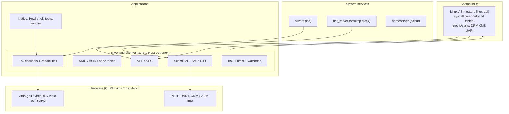

# WerewolfOS System Architecture

> Status: living document, English edition 2026-11-25. The superseded Russian
> console-era draft is kept at [ARCHITECTURE.ru-2026-11-20.md](archive/ARCHITECTURE.ru-2026-11-20.md).
> Implementation status markers follow [STATUS.md](STATUS.md): **IMPLEMENTED**,
> **PARTIALLY IMPLEMENTED**, **EXPERIMENTAL**, **PLANNED**.

## 1. One OS, one kernel, several userspace configurations

WerewolfOS is a single operating system built on the **Silver microkernel** —
an independent, no_std Rust kernel targeting AArch64. WerewolfOS is both the
kernel and its userspace layers, including the Linux compatibility layer:
there is no separate "guest OS" below the kernel.

The kernel deliberately knows nothing about which configuration is running.
Configurations are assembled at the image level from shared system components:

| Configuration | Userspace | Linux ABI | Status |
|---|---|---|---|
| Console / IoT | Silver native userspace (Howl, services, toolbox) | Optional | IMPLEMENTED (primary) |
| Mobile | Debian arm64 glibc stack + OpenRC + Denial WM (Wayland) | Required | PARTIALLY IMPLEMENTED (active development) |

Gaming profiles, RISC-V ports and other future directions are not covered
here; they are not being worked on and are not claimed anywhere.

## 2. Layer diagram



The Linux ABI is a kernel feature, not a second kernel: with the `linux-abi`
cargo feature disabled, none of it is linked and the image is purely native.

## 3. Core design rules

1. **The kernel depends on no distribution.** Alpine, OpenRC, Debian and
   Denial WM are image-level components of the Mobile configuration. The
   kernel's boot chain (silverd init, SFS) is native and self-contained.
2. **Drivers are isolated tasks, not kernel code.** MMIO/IRQ/PCI access is
   granted through capabilities; a crashed driver does not crash the system.
   (Kernel-side plumbing IMPLEMENTED; full driver-process split for every
   device is PARTIALLY IMPLEMENTED — virtio-net/net_server already runs this
   way.)
3. **Fail closed.** Every resource the kernel hands out (frames, IRQs, DMA,
   scheduling classes) passes a policy check (`mem_policy`, `irq_policy`,
   `gicv3_policy`, `watchdog_policy`, `sched_policy`, `cache_policy`).
4. **One fault domain per task.** EL0 faults kill the task and are reaped by
   the kernel; a kernel panic is reserved for kernel bugs.
5. **No marketing claims.** Every capability is marked with its verification
   level in STATUS.md. What is not tested is not claimed.

## 4. Boot chain (QEMU `virt`)

```
QEMU -machine virt -cpu cortex-a72 -smp N
  └─ Silver kernel image (relocatable, linked per platform)
       ├─ early UART console (PL011)
       ├─ FDT parsing (memory, PCIe, SDHCI, GIC)
       ├─ frame allocator + mem reserve pass
       ├─ MMU/ASID/SMP self-tests (fail closed on mismatch)
       ├─ block probe: DTB/PCI SDHCI, then virtio-blk; virtio gpu/net
       └─ silverd (native init) spawns:
             ├─ net_server (smoltcp: DHCP/DNS/TCP/TLS)
             ├─ nameserver (Scout IPC name resolution)
             └─ Howl (shell) / native tools
       Linux ABI images boot instead via `linuxrun /sfs/sbin/init`
       (busybox + OpenRC + Debian glibc stack for Mobile).
```

## 5. Inter-component contracts

| Boundary | Mechanism | Notes |
|---|---|---|
| Kernel ↔ native task | Syscall ABI (EL0 SVC), IPC channels | Channel-based, capability-checked |
| Kernel ↔ Linux task | Linux syscall personality (`linux_abi/`) | Same kernel services, translated |
| Task ↔ task | IPC channels over named endpoints (Scout) | Owned capabilities |
| Task ↔ device | Device fds (`Target::*` in `linux_fd.rs`) / native caps | DRM, udmabuf, input planned |
| Kernel ↔ block/net HW | SDHCI or virtio-pci block in-kernel; virtio-net in a driver task plus userspace stack process | Partitioned per device |

## 6. Where the code lives

| Path | Contents |
|---|---|
| `src/` | The kernel crate (single binary, feature-gated layers) |
| `src/scheduler/` | Scheduler module: `mod.rs` (queues, spawn/wait/exit, switch) and `selftest.rs` (boot probes) |
| `userspace/` | Native userspace crate (silverd, Howl, net_server, tools, ELF engine) |
| `tests/linux/` | Freestanding Linux-ABI test programs (glibc-free probes) |
| `tools/` | Image builders (Alpine edge + Debian trixie staging), boot/dump scripts |
| `scripts/` | SFS image creation/injection/fsck tooling, release bundle (`make_release.sh`), release gate (`release_smoke.py`) |
| `docs/` | This documentation set; start at [README.md](README.md), modularisation in [REFACTOR.md](REFACTOR.md) |
| `docs/archive/` | Superseded documents, kept for provenance only |
