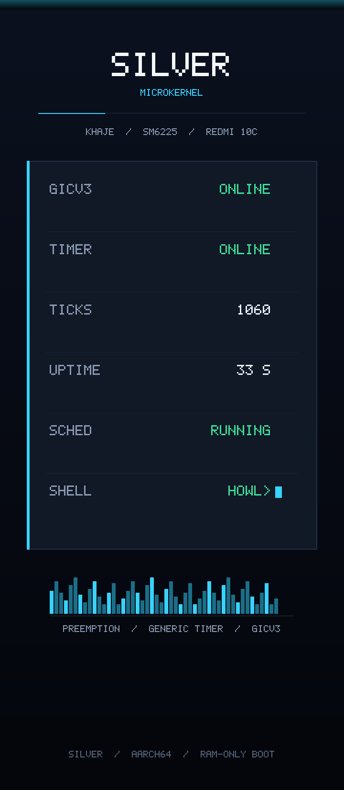

# Silver Microkernel — Redmi 10C bring-up

Minimal RAM-only path for booting Silver on a Xiaomi Redmi 10C and reaching the
Howl shell prompt:

```text
howl>
```

This is a focused hardware bring-up, not a full WerewolfOS port. SFS, SMP,
Wi-Fi, GPU, display, audio, the full driver set and the rest of the normal
desktop boot are out of scope for the first hardware milestone.

## Verified on hardware



The panel above is painted by the kernel itself on the physical Redmi 10C
(`rain`, SM6225 / khaje) during a RAM-only `fastboot boot`: GICv3 and the
Generic Timer are online, 1060 timer interrupts have been delivered, the
scheduler is running and the Howl task is alive. The image is a render of the
exact `fog-ui` layout; the on-device photograph is kept with the task notes.

## Target

| Field | Value |
| --- | --- |
| Device | Xiaomi Redmi 10C |
| Codename | `fog` |
| SoC | Qualcomm SM6225 / Snapdragon 680 |
| Platform name | `khaje` |
| DRAM base | 0x4000_0000 (4 GiB-base Qualcomm platform) |

## Status

- The `fog` build compiles and links against `linker_fog.ld`.
- The boot stub captures the hand-over state and records the address ABL
  actually used. A standard `fog` build does **not** relocate: if the entry
  address differs from the link address it writes `pc`/`link`/`delta` into
  `BOOT_PARAMS` and parks. The self-relocation copy is an explicit
  `fog-reloc` build feature.
- `fog-reloc` now performs a **pre-copy live-FDT check**: the destination span
  must be inside `/memory` and outside every `/reserved-memory` child, the
  memreserve map, the DTB and the running source image. The validator uses no
  allocation or statics and fails closed on unknown cell layouts, non-empty
  `ranges` or malformed trees.
- Platform identity, memory, reservations, UART, GICv3 and the timer INTID are
  read from the live FDT. Nothing is inferred from "unknown CPU means tablet".
- A full fog-path integration test runs on QEMU `virt` with a synthetic
  khaje-like DTB in three cases: `fog-reloc` relocation, default at-link boot,
  and default fail-closed park.
- **Real-device status: verified on a `rain` unit** (2026-11-03). RAM-only
  `fastboot boot` reaches the scheduler, the Howl task and the live `fog-ui`
  panel; the Generic Timer delivers interrupts at the expected rate. The
  missing piece was GICv3 affinity routing: ABL leaves `GICD_CTLR.ARE_NS = 0`,
  and this unit ignores `EnableGrp1NS` until `ARE_NS` is set, leaving the
  redistributor SGI/PPI frame inert. `start_distributor()` now writes
  `ARE_NS`, drains `RWP`, then enables Group 1 NS. Measured on the unit:
  `GICD_CTLR = 0x12`, `GICR_ISENABLER0 = 0x40001`,
  `GICR_IPRIORITYR[18] = 0xA0`, timer IRQs > 1000.
- UART wiring/clocking is still unverified; the live framebuffer panel is the
  proof channel for the first milestone.

The QEMU test is a validation of the Silver-side logic. It is not evidence that
the same addresses or devices exist on the phone.

### Verification snapshot (2026-11-03)

| Check | Result |
| --- | --- |
| Host unit tests | 77 passed / 0 failed |
| Fog QEMU, `fog-reloc` at `0x4040_0000` | PASS: FDT-validated relocation, `TIMER TEST: ticks=30`, `howl>` |
| Fog QEMU, default at `0x4008_0000` | PASS: no relocation, `howl>` |
| Fog QEMU, default at `0x4040_0000` | PASS fail-closed: no serial output, no `howl>`; `BOOT_PARAMS` holds pc/link/delta |
| Fog QEMU, `fog-reloc` into a reserved destination | PASS fail-closed: FDT rejects before copy, no serial output, no `howl>` |
| Normal QEMU | PASS: `PLATFORM=QEMU`, timer ticks, `howl>` |
| Demo regression | 66 PASS / 0 unexpected FAIL / 0 PANIC |
| Tablet build | PASS |
| Fog boot image v3 | PASS: `ANDROID!`, header v3 |
| **Real Redmi 10C (`rain`), RAM-only `fastboot boot`** | **PASS: boot stub, relocation/FDT proof, MMU, heap, GICv3, timer, scheduler, Howl task** |
| **GICv3 PPI 18 delivery on hardware** | **PASS: `GICD_CTLR=0x12`, `GICR_ISENABLER0=0x40001`, IRQ count > 1000** |

GICv3 now matches the boot CPU's redistributor by `GICR_TYPER` affinity and has
**no frame-0 fallback**. When no redistributor matches, the timer PPI is left
disabled, `TIMER TEST` is skipped and the scheduler does not pretend that
preemption works.

Hardware readiness: **first milestone reached** — the kernel boots, the timer
preempts and the Howl task runs on the unit. Console I/O over the GENI UART is
still unverified; see the remaining unconfirmed parameters below.

### Connected-unit note (2026-11-03)

A unit was reachable over ADB: Xiaomi `220333QNY`, codename **`rain`** (Redmi
10C NFC), `ro.product.name=rain_global`, `ro.board.platform=bengal`,
`ro.soc.model=SM6225`, `/sys/devices/soc0/machine=KHAJE`, 4 GB RAM. It is the
same khaje/SM6225 family as `fog`, but it is not the non-NFC `fog` codename.

The ADB property `ro.boot.flash.locked=1` was misleading: `fastboot getvar
unlocked` reports **`unlocked: yes`**. Only RAM-only `fastboot boot` was used —
no flash, no unlock, no EDL. ADB without root cannot read `/proc/iomem` or the
FDT properties; only directory names and some `/sys` files were available.

Useful read-only observations from `rain`:

- `/sys/devices/soc0/machine = KHAJE`, `soc_id = 518`, family Snapdragon;
- `/sys/firmware/devicetree/base/reserved-memory` includes `hyp_region@45700000`,
  `sec_apps_region@45fff000`, `xbl_aop_region@45e00000`,
  `smem_region@46000000`, `modem_region@4ab00000`, `adsp`/`cdsp` regions around
  `0x51..0x53`, `cont_splash_region@5c000000`, `ramoops@5D000000` and
  `removed_region@60000000`;
- 4 GB RAM (`MemTotal` ≈ 3.75 GB), dtbo overlay index 58.

These are `rain` observations. The live FDT passed to the kernel confirmed the
memory window, the GIC bases and the timer INTID, and the RAM-only boot on this
unit used exactly those live values.

## Architecture decision

Two options were evaluated:

**A. A separate position-independent shim.** ABL starts a small loader, the
loader parses the FDT, copies Silver to a chosen physical address and jumps to
it. `ios-fog` uses this shape successfully for XNU.

**B. Make Silver's own early entry relocate.** The boot stub measures the
address ABL used, moves the whole image to the link address with a
`memmove`-style copy, and continues from the copy.

**Option B was chosen, but the copy is opt-in.** Reasons:

- Silver's very early stub is already almost position-independent: it uses
  `adr` for `_start`, PC-relative stack setup and a header-relative image size.
- After a successful copy, every existing absolute reference, the linker
  layout, the MMU tables and the allocator keep working unchanged.
- No second build artifact, no second copy of FDT/UART/log code, and no
  loader/kernel ABI to keep in sync.
- The measured hand-over PC, the link address and the delta are recorded, so a
  wrong placement is observable rather than silent.

The trade-off is that the relocation destination (`0x4008_0000`) is a
configured assumption: it must be free RAM on the unit, and the early stub has
no way to prove that before the MMU/FDT are available. Therefore the standard
`fog` build refuses to copy: a non-link entry parks after recording the
diagnostics. `--features no_std,fog,fog-reloc` enables the copy path, which
still fails closed on a bad ARM64 header, a wild image size, an unaligned or
out-of-range source/destination span (both ends), an overflowing span, or any
overlap. Address match alone is never treated as proof of the hardware map.

The pre-copy live-FDT validation is now implemented in `src/fog_validate.rs`:
the destination must be inside a `/memory` region and outside every
reservation, memreserve, the DTB and the source image. It is deliberately
conservative (2/2 address/size cells, no `ranges` translation) and returns
"park" on anything it cannot prove. `fog-reloc` therefore remains an opt-in
experiment until it has been exercised on a real unit; the default build still
never copies.

## Boot flow

1. **Entry** (`src/main.rs`, `.text.boot`)
   - mask DAIF;
   - best-effort claim the boot path (no `MPIDR == 0` assumption; MMU-off memory is Device, so no exclusive monitor) and park
     every other core that reaches the stub; the PoC runs on the boot CPU
     only, and the observed `MPIDR_EL1` is recorded in the log;
   - save `x0` (DTB) and the actual image base (`adr _head`);
   - normalize MMU/caches, measure `CurrentEL`, `SCTLR_EL1`, `MPIDR_EL1`;
   - if the actual base differs from `__kernel_link_pa`:
     - standard build: publish `BOOT_PARAMS` and park (no copy);
     - `fog-reloc` build: validate magic, size, both span ends, overflow and
       non-overlap, then run the pre-copy live-FDT destination proof, then copy
       the whole image and continue inside the copy;
   - publish `BOOT_PARAMS` in `.data`;
   - set `SP_EL1` to the image's own stack;
   - zero `.bss`, build boot page tables, enable the MMU, jump to the high
     half, install the real vectors.

2. **Probe** (`src/fog.rs`, `src/fdt.rs`)
   - validate the DTB magic/totalsize and parse the tree;
   - require a `qcom,khaje*` or `qcom,sm6225` root compatible;
   - collect `/memory`, `/reserved-memory`, the DTB memreserve map, `model`,
     `compatible`, the UART node, the GIC node and the timer INTID;
   - compute one frame-allocator window that is proven RAM and intersects no
     reservation, no part of the image and not the DTB;
   - publish the UART base and GIC configuration.

3. **Core bring-up** (`kernel_main`)
   - initialise the MMU and the platform console;
   - print the hand-over evidence and halt if the memory map is unproven;
   - init the frame allocator and the kernel heap;
   - init GICv3 and the ARM generic timer;
   - init the VFS and seed the small bootstrap files.

4. **Fog userspace** (`scheduler::init_fog`)
   - spawn idle, Scout (the nameserver) and Howl;
   - give Howl the console;
   - Howl prints `howl>` and falls back to the kernel console for input when no
     userspace Howler is present.

## Live FDT vs configured constants

Read from the live FDT:

- `model`, root `compatible`;
- `/memory` regions;
- `/reserved-memory` children;
- the DTB memory-reservation map;
- the UART node: physical base, GENI vs PL011, and its INTID;
- the GIC node: V2/V3, distributor base, CPU-interface/redistributor base,
  redistributor size and stride;
- the non-secure physical timer PPI;
- `/chosen` `bootargs` / `stdout-path` (logged, not blindly trusted over a real
  UART node).

Configured (documented assumptions, not hardware facts):

- the link/relocation address `0x4008_0000` in `linker_fog.ld`;
- the mapped DRAM window `0x4000_0000..0x8000_0000` (1 GiB) in `src/memory.rs`;
- the compile-time khaje GIC defaults used only if the FDT has no GIC node;
- the default 19.2 MHz timer frequency used only if `CNTFRQ_EL0` reads zero.

## Memory safety rules

- The frame allocator never receives "all memory after the kernel". It receives
  one window chosen by `fdt::select_allocator_window` after subtracting every
  reservation, the image span and the DTB.
- The planner aligns every candidate to 4 KiB, ignores reversed/overflowing
  regions and fails closed when no window of at least 4 MiB survives.
- An empty or invalid window stops the boot before `frame_allocator::init`
  asserts.
- Reserved DRAM is still mapped in the kernel high half (the page tables cover
  the mapped gigabyte), but no allocator frame is ever taken from it.

## Diagnostic log

The first fog boot prints (over the FDT-discovered UART):

```text
SILVER FOG ENTRY
SILVER BOOT PARAMS OK pc=... el=1 sctlr=... mpidr=... delta=...
SILVER FDT OK size=... model=... compatible=...
SILVER MEMORY MAP OK base=... size=... reserved=... resv=... memresv=... dtb=...
SILVER GIC OK kind=gicv3
SILVER UART OK base=... debug=... kind=geni|pl011
SILVER MMU OK
SILVER FRAME ALLOCATOR OK
SILVER HEAP OK base=...
TIMER TEST: ticks=30 ...          # or: SKIP (no confirmed GIC redistributor)
SILVER PLATFORM READY
SILVER SCHEDULER START
howl>
```

If the GICv3 redistributor cannot be matched, the banner also contains
`GICV3: no redistributor matches this CPU; timer PPI left disabled`, and the
timer is not armed.

`pc` is the address ABL actually used; `delta` is `pc - 0x4008_0000`. If those
two disagree with expectations, the log already contains the measurement needed
to relink or adjust the relocation slot.

A standard build that parks on a non-link entry produces no console output, but
it writes the same record at the actual load base before parking:
`BOOT_PARAMS+0x00` magic, `+0x08` pc, `+0x30` link address, `+0x48` delta.
A debugger or a loader that can read RAM can recover it.

## Build

Kernel only:

```sh
cargo build --release --target aarch64-unknown-none \
    --no-default-features --features no_std,fog
```

The output ELF is `target/aarch64-unknown-none/release/silver_microkernel`.
`build.rs` selects `linker_fog.ld` and still embeds the userspace ELFs. This
default build parks when ABL does not enter it at `0x4008_0000`.

The explicit relocation experiment is a separate build:

```sh
cargo build --release --target aarch64-unknown-none \
    --no-default-features --features no_std,fog,fog-reloc
```

Only use it after the destination is independently proven free on the unit.

Boot image (build only, never flashes):

```sh
redmi10c_poc/build_boot_image.sh
```

This produces `redmi10c_poc/out/boot.img` (header v3) and verifies the raw
arm64 Image header. It requires AOSP `mkbootimg`. It prints the `fastboot boot`
command but does not run it.

## QEMU integration test

```sh
redmi10c_poc/test_fog_qemu.sh
```

The test builds two kernels and runs four cases:

- `fog-reloc` entered at `0x4040_0000` while linked at `0x4008_0000`: the
  explicit copy path must relocate and reach the full banner plus `howl>`;
- standard `fog` entered exactly at `0x4008_0000`: no copy is needed and the
  default build must boot normally;
- standard `fog` entered at `0x4040_0000`: relocation is disabled, so the stub
  must park without printing the banner or reaching `howl>`;
- `fog-reloc` with a DTB whose `/reserved-memory` covers `0x4008_0000`: the
  pre-copy FDT validation must reject the destination and park before copying.

All cases boot QEMU `virt` with `gic-version=3` and a synthetic khaje-like DTB.
The GICv3 redistributor is located by `GICR_TYPER` affinity; a missing match is
reported and the timer is left disabled instead of using frame 0.

It is a simulation and does not prove anything about the phone's hardware.

### Visual debug ladder (`fog-paint`)

A UART-less unit has no console. For a controlled diagnostic boot only, build
with the opt-in `fog-paint` feature:

```sh
cargo build --release --target aarch64-unknown-none \
    --no-default-features --features no_std,fog,fog-reloc,fog-paint
```

It fills the Rain/Fog `cont_splash` framebuffer at `0x5C00_0000` with a colour
at each milestone:

| Colour | Milestone |
| --- | --- |
| green | payload executed at least to the boot claim |
| blue | placement policy passed (at-link or checked copy) |
| cyan | MMU is on |
| yellow | console/probe path is alive |
| magenta | frame allocator + kernel heap are alive |
| orange | GIC/timer path completed |
| white | scheduler is about to start |

This is a diagnostic aid, not a normal build: it assumes the `rain`
reserved-memory base and is outside the QEMU test's 128 MB RAM. The normal fog
image does not touch the framebuffer.

## Hardware bring-up plan

1. **Measure, do not assume.** On the unit, capture the hand-over PC, `CurrentEL`,
   `SCTLR_EL1`, `MPIDR_EL1`, the DTB pointer/size and whether the log appears.
   The first `SILVER BOOT PARAMS` line is designed for exactly this.
2. **Confirm the load slot.** A standard build parks when `delta != 0`, so
   first measure the hand-over address and prove the destination free from the
   live memory map. Then either relink `__kernel_link_pa`/`. =` to that slot or
   use `fog-reloc` for a controlled experiment.
3. **Confirm the UART.** The live FDT node gives the base; the remaining
   unknowns are board wiring, pin muxing and whether ABL leaves the SE clock
   running. If the banner is missing, the next fallback is the framebuffer or
   ramoops, not a guessed MMIO address.
4. **Confirm the memory map.** The log prints the selected window and the first
   reservation. Compare it with `/proc/iomem`, the live FDT and the unit's RAM
   variant.
5. **Confirm the GIC/timer.** The timer test line (`TIMER TEST: ticks=...`)
   proves interrupt delivery before the scheduler starts.
6. **Reach Howl.** Only after the above: `howl>` on the real UART.
7. **Input.** The kernel GENI RX path is implemented but unverified on hardware.
   Howl falls back to `SYS_READ` when no userspace Howler is running.

## Unconfirmed parameters

These are **not** established facts for this unit and must be measured:

- the physical address ABL actually loads the Image at;
- whether `0x4008_0000` is free when ABL loads elsewhere;
- UART availability, pins, pin mux and SE clock state;
- the exact live DRAM banks and reserved-memory carve-outs of this unit;
- the live FDT cell layout (`#address-cells`/`#size-cells`) and whether
  `/reserved-memory` uses non-empty `ranges`; the validator parks if either is
  outside its conservative 2/2, absolute-reg support;
- whether the target is a `fog` unit or the NFC `rain` sibling; the connected
  `rain` unit is the same KHAJE/SM6225 platform but is not a `fog` measurement;
- the boot CPU identity beyond the `MPIDR_EL1` value in the log;
- the boot CPU's redistributor affinity in the live `GICR_TYPER` map;
- the boot image format/AVB requirements of the installed bootloader;
- whether a serial log, framebuffer log or persistent ramoops log is available
  without extra hardware access;
- GENI RX correctness on this SE instance;
- watchdog/thermal/XPU behaviour during a failed boot.

No address in this document is asserted as a measured hardware fact unless the
log says so.

## Known limitations

- The PoC is single-core; AP bring-up remains disabled. Secondary cores that
  reach the stub are parked with a WFE loop. The boot path is claimed
  before any state is touched, so the boot CPU does not have to be `MPIDR`
  affinity 0. A standard build never copies, so it cannot overwrite a
  secondary's park loop; the opt-in `fog-reloc` path still cannot prove that
  the destination or the bytes between the spans are dead, which is why it is
  not the default.
- The normal QEMU boot path still spawns silverd and the virtio driver set; the
  fog path deliberately spawns only Scout and Howl.
- The fog path uses a 1 GiB mapped DRAM window. Using the higher banks would
  need additional page tables and is not part of the first milestone.
- The boot image script requires an unlocked bootloader to try the image, but
  the script itself performs no device operation.
- The live FDT must be inside the mapped first gigabyte for the probe to read
  it; a DTB above that is reported and the boot stops instead of inventing a
  mapping.

## Relevant files

- `linker_fog.ld` — high-half VMA, `0x4008_0000` link/relocation slot.
- `src/main.rs` — entry stub, hand-over capture, fail-closed placement policy,
  fog boot order.
- `src/boot.rs` — `BOOT_PARAMS` layout shared with the assembly stub.
- `src/fdt.rs` — allocation-free DTB parser and boot-memory planner (host
  tested).
- `src/reloc.rs` — host-tested relocation boundary policy mirrored by the stub.
- `src/fog_validate.rs` — pre-relocation live-FDT destination proof (host
  tested; called from the assembly stub before any copy).
- `src/fog.rs` — khaje probe, FDT-derived memory window, banner.
- `src/memory.rs` — fog DRAM window and the FDT-selected allocator window.
- `src/platform.rs` — `Kind::{Qemu,Sm8650,Fog,Unknown}`.
- `src/console.rs`, `src/geni_uart.rs`, `src/pl011.rs` — FDT-driven console.
- `src/gic.rs`, `src/gicv3.rs`, `src/gicv3_policy.rs` — runtime GIC
  configuration and host-tested redistributor matching.
- `src/timer.rs` — timer arming gated by `gic::timer_available()`.
- `src/scheduler.rs` — `init_fog` (Scout + Howl).
- `userspace/src/bin/silvershell.rs` — `SYS_READ` fallback when Howler is absent.
- `redmi10c_poc/test_fog_qemu.sh` — end-to-end QEMU simulation.
- `redmi10c_poc/build_boot_image.sh` — RAM-only boot image builder (no flash).
